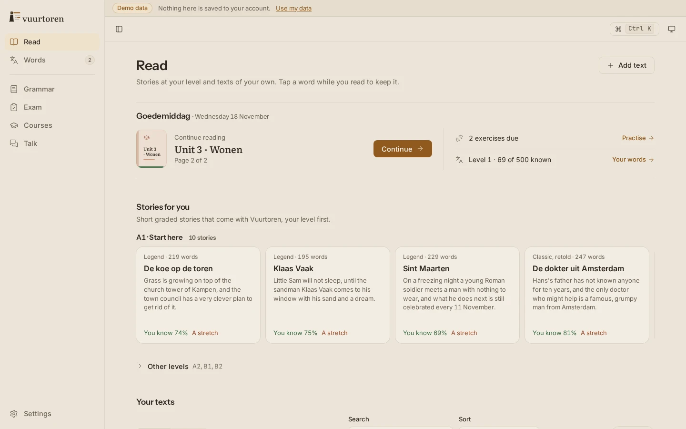

  <picture>
    <source media="(prefers-color-scheme: dark)" srcset="docs/images/logo-dark.svg">
    <source media="(prefers-color-scheme: light)" srcset="docs/images/logo-light.svg">
    
  </picture>

  <strong>Flashcards meet reading. Read Dutch at your level.</strong> 
  Local-first, open, and works with <a href="https://apps.ankiweb.net/">Anki</a>.

  
  
  
  

<picture>
  <source media="(prefers-color-scheme: dark)" srcset="docs/images/read-dark.webp">
  
</picture>

## Why Vuurtoren

While learning Dutch, I ran into a problem: there were hardly any texts suited to a beginner
reader. On top of that, learning the words from them was tedious.

Vuurtoren tries to solve both:

1. It adapts any text to your level, from the words you have learnt: an article, a PDF, a photo
   of a page or your course book.
2. It makes learning the words from that text easy. One tap turns a word into a flashcard with
   the sentence you found it in, and the cards are scheduled with FSRS, the same algorithm
   [Anki](https://apps.ankiweb.net/) uses.

Your data stays on your devices, in an open format, and exports to Anki.

About the name: vuurtoren is Dutch for lighthouse. A lighthouse helps you find your way through
unfamiliar water, and that is what I want this app to do for a text.

## What it does

**Reading.** Open a story at your level, a web page, a PDF or a photo of a page from your course
book. Vuurtoren picks a few new words on each page to focus on and, based on the words you know,
translates the rest, so the text stays readable. Tap a word to see its meaning in that sentence,
its grammar and its forms. Side by side puts each sentence next to its English and highlights
each word together with its translation.

**Words.** Every word you tap while reading can become a card, with the sentence you found it
in. Cards are reviewed with FSRS, the same scheduler [Anki](https://apps.ankiweb.net/) uses. Import
the Anki decks you already have, so the app knows your level, or keep reviewing in Anki and use
Vuurtoren only for reading. Starting from zero? Vuurtoren comes with about 5000 of the most common Dutch
words.

**Grammar and the exam.** Grammar such as inversion, separable verbs and the perfect tense is
marked where it appears in your texts, and the Grammar section explains topics from A1 to C1.
Exercises practise what you read, and mock exams prepare you for the A2 inburgeringsexamen. AI is
there only if you want it, with your own key: stories at your level, sentences explained, a chat
partner who keeps to words you know. See [AI](docs/ai.md) for the setup.

**Your data.** Everything lives on your devices and works offline. Sync is encrypted with your
passphrase and goes through your own server, WebDAV or a Syncthing folder. Can't self-host?
**Vuurtoren Sync** is coming: sign in on each device and they sync, with nothing to set up.

## Get Vuurtoren

  
  
  
  

  <a href="https://vuurtoren.app">vuurtoren.app</a> ·
  <a href="docs/guide/install.md">Install</a> ·
  <a href="docs/guide/sync.md">Sync your devices</a> ·
  <a href="docs/phones.md">On your phone</a> ·
  <a href="docs/guide/self-host.md">Your own sync server</a> ·
  <a href="docs/dev/README.md">For developers</a>

## Licence

The code is MIT. The content in `content/` (the starter words and the stories) is CC BY-SA
4.0, because the dictionary and sentence sources it is built from are; see [content/LICENSE](content/LICENSE). Vuurtoren is an independent project; it talks to Anki
through the AnkiConnect add-on.
