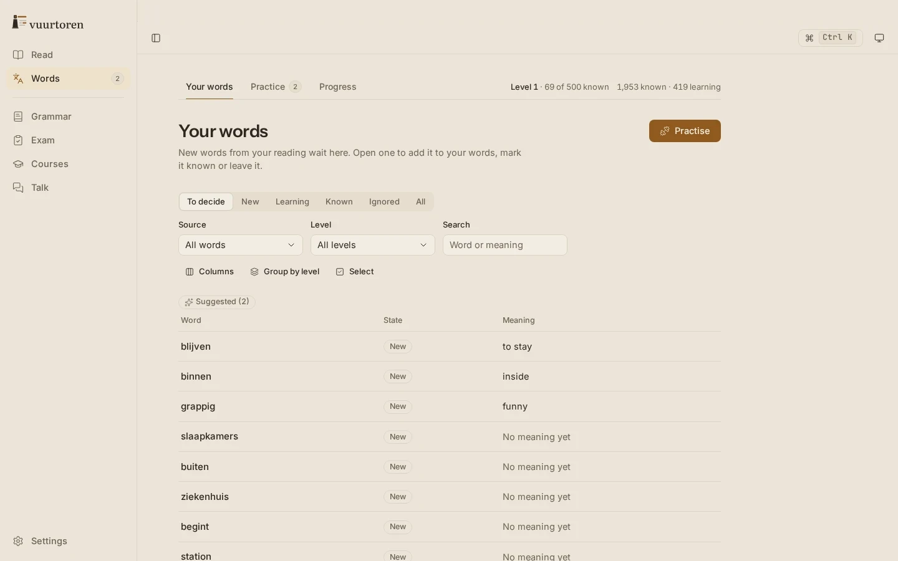
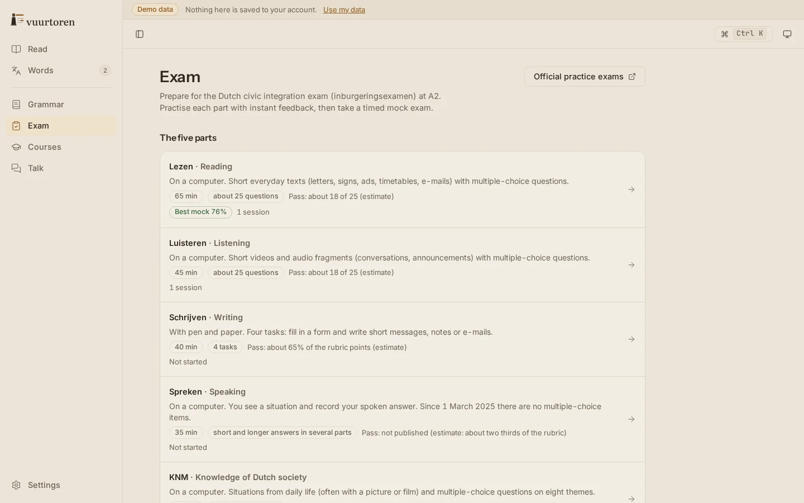
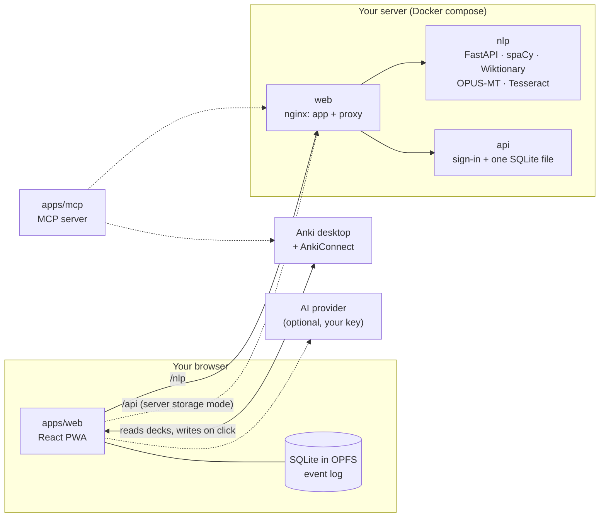

<p align="center">
  <picture>
    <source media="(prefers-color-scheme: dark)" srcset="docs/images/logo-dark.svg">
    <source media="(prefers-color-scheme: light)" srcset="docs/images/logo-light.svg">
    
  </picture>
</p>

<p align="center">
  <strong>Read Dutch with the words you already know.</strong><br>
  An open-source, self-hosted reader that uses your Anki decks as the record of your vocabulary.
</p>

<p align="center">
  <a href="https://github.com/pavlohrab/Kenning/actions/workflows/ci.yml"></a>
  <a href="https://github.com/pavlohrab/Kenning/actions/workflows/images.yml"></a>
  <a href="#licence"></a>
  <a href="deploy/README.md"></a>
  
  
</p>

<p align="center">
  <a href="#quick-start">Quick start</a> ·
  <a href="#a-tour">Tour</a> ·
  <a href="#how-it-works">How it works</a> ·
  <a href="#architecture">Architecture</a> ·
  <a href="#roadmap">Roadmap</a> ·
  <a href="docs/README.md">Docs</a>
</p>

<picture>
  <source media="(prefers-color-scheme: dark)" srcset="docs/images/home-dark.webp">
  <source media="(prefers-color-scheme: light)" srcset="docs/images/home-light.webp">
  
</picture>

You already study Dutch words in Anki. Kenning reads your decks, works out which words you
really know, and turns any text (an article, a PDF, a photo of a page, your textbook) into
reading at the right level: words you know stay plain, a few words worth learning now are
highlighted, and the rest are glossed. When you meet a word you want, one click sends it back
to Anki with the sentence you found it in.

### Why "Kenning"?

> Dutch _kennen_ is "to know" and _kennis_ is "knowledge"; English keeps the word in _ken_, as
> in "beyond my ken", the range of what you know. In Old Norse and Old English poetry a
> _kenning_ is a compound metaphor: "whale-road" for the sea, "word-hoard" for vocabulary.
> Dutch still thinks that way: its word for vocabulary is _woordenschat_, a "treasure of words".
> Kenning is about growing yours.

## Highlights

- **Your Anki decks are the source of truth.** Dutch decks and fields are found automatically;
  each card's interval (SM-2) or stability (FSRS) becomes a recall probability.
- **Graded reading of your own texts.** Paste, a web address, a PDF (OCR for scans) or a photo.
  Read, Cloze and Gloss modes, an exact new-words budget per page, and cloze hints.
- **Real Dutch analysis.** spaCy plus rules for separable verbs (_bel … op_ → _opbellen_),
  compounds glossed from their parts, an offline Wiktionary dictionary and offline sentence
  translation.
- **Practice, grammar, exam.** Exercises without AI on their own FSRS schedule, 24 grammar topic
  pages with examples from what you read, and preparation for the A2 inburgeringsexamen.
- **Study along your textbook.** Import the course book you own; units, word lists and
  exercises are found and matched to your decks.
- **No AI needed; bring your own key if you want it.** Talk, stories and explanations are
  optional extras with Anthropic, any OpenAI-compatible provider, or a local model.
- **Private and self-hosted.** Your data lives in your browser or in one SQLite file on your own
  server. Kenning writes to Anki only when you click.

## A tour

<table>
  <tr>
    <td width="50%" valign="top">
      <h3>Reader</h3>
      Pages of about 150 words. Amber marks the few words worth learning now; the grammar
      focus underlines one topic at a time. Click a word for its dictionary form, meaning,
      decks, live Anki state and the grammar it takes part in, then <b>Add to Anki</b>,
      <b>Study first in Anki</b> or <b>Mark known</b>.
    </td>
    <td width="50%" valign="top">
      <h3>Words</h3>
      The hub for everything Kenning knows about your vocabulary, from Anki and from your
      reading. Filter by state or source (a text, a course unit, practice), open the same
      inspector, then add, practise or talk about a selection in bulk.
    </td>
  </tr>
  <tr>
    <td>
      <picture>
        <source media="(prefers-color-scheme: dark)" srcset="docs/images/reader-dark.webp">
        
      </picture>
    </td>
    <td>
      <picture>
        <source media="(prefers-color-scheme: dark)" srcset="docs/images/words-dark.webp">
        
      </picture>
    </td>
  </tr>
  <tr>
    <td width="50%" valign="top">
      <h3>Practice</h3>
      Meaning, cloze, de/het, separable verbs, perfect tense with hebben/zijn, forms, word order
      and dictation, each scheduled per word and skill with FSRS. Practice never writes to
      Anki; it counts as evidence that you are learning a word.
    </td>
    <td width="50%" valign="top">
      <h3>Courses</h3>
      Study along a textbook you own: import a PDF, EPUB or page photos, get the outline, each
      unit's texts and words matched to your Anki decks, and the book's exercises with checking.
    </td>
  </tr>
  <tr>
    <td>
      <picture>
        <source media="(prefers-color-scheme: dark)" srcset="docs/images/practice-dark.webp">
        
      </picture>
    </td>
    <td>
      <picture>
        <source media="(prefers-color-scheme: dark)" srcset="docs/images/courses-dark.webp">
        
      </picture>
    </td>
  </tr>
  <tr>
    <td width="50%" valign="top">
      <h3>Grammar</h3>
      A learning path of 24 Dutch topics, each with an explanation, examples from your own
      texts (then Tatoeba), common mistakes and focused practice.
    </td>
    <td width="50%" valign="top">
      <h3>Exam</h3>
      The A2 inburgeringsexamen at a glance, with practice and timed mock exams for Lezen,
      Luisteren, Schrijven, Spreken and KNM, all original content.
    </td>
  </tr>
  <tr>
    <td>
      <picture>
        <source media="(prefers-color-scheme: dark)" srcset="docs/images/grammar-dark.webp">
        
      </picture>
    </td>
    <td>
      <picture>
        <source media="(prefers-color-scheme: dark)" srcset="docs/images/exam-dark.webp">
        
      </picture>
    </td>
  </tr>
  <tr>
    <td width="50%" valign="top">
      <h3>Library</h3>
      Your shelf of texts, with how much of each you already know, where you left off, and
      <b>Create a story</b> when an AI provider is set.
    </td>
    <td width="50%" valign="top">
      <h3>Talk <sup>optional AI</sup></h3>
      A short chat in Dutch that stays within the words you know, corrects your messages and
      offers new words for Anki. Hidden until you add a provider.
    </td>
  </tr>
  <tr>
    <td>
      <picture>
        <source media="(prefers-color-scheme: dark)" srcset="docs/images/library-dark.webp">
        
      </picture>
    </td>
    <td>
      <picture>
        <source media="(prefers-color-scheme: dark)" srcset="docs/images/talk-dark.webp">
        
      </picture>
    </td>
  </tr>
</table>

<sub>Screenshots use the built-in demo data (<code>?demo</code>) and follow your GitHub theme.</sub>

## How it works

**Anki is the record of what you know.** Kenning finds your Dutch decks and their word,
sentence and gloss fields, merges them, and turns each card into a recall probability (SM-2
decay since the last review, or FSRS stability). A word counts as known at an interval of 21
days or more with recall of at least 0.6. Answers you give in Kenning (practice, clozes, book
exercises) add evidence that you are learning a word but never make it known; only Anki or an
explicit **Mark known** does that.

**Algorithms, not AI, by default.** Texts are analysed by spaCy with precision rules for lemma
choice, separable verbs, te-forms and compounds. Meanings come from an offline Wiktionary
dictionary; sentences are translated by an offline OPUS-MT model on your own server. Per page,
a planner decides which words to leave plain, which few to introduce and which to blank as
clozes, and a staircase controller adapts the new-word budget to how you read. Practice is
scheduled with FSRS per (word, skill), and grammar detectors are rule-based. Every rule and
threshold is written down in [docs/algorithms.md](docs/algorithms.md).

**AI is optional, with your own key.** Add a provider in Settings (Anthropic, OpenAI, Gemini,
OpenRouter, Groq, DeepSeek, Mistral, or a local Ollama / LM Studio) to unlock Talk, Explain
this sentence, Simplify this page, stories at your level, extra example sentences and
exercises like your textbook's. Generated text is checked against your vocabulary and by the
language server before you see it. There is also an MCP server for Claude Desktop and Claude
Code. Details: [docs/ai.md](docs/ai.md).

**Privacy.** No telemetry and no third-party scripts. AI requests go from your browser straight
to the provider you chose; the key stays on your device (optionally encrypted with a
passphrase) and is never written to your data, backups or the server. Kenning talks to Anki
through AnkiConnect from your browser and writes only when you click (Add, Study first, Mark
known), tagging every note it touches.

## Quick start

You need [Docker](https://docs.docker.com/get-docker/) and, for your vocabulary, Anki desktop
with the [AnkiConnect](https://ankiweb.net/shared/info/2055492159) add-on (code `2055492159`).

```sh
git clone https://github.com/pavlohrab/Kenning.git && cd Kenning
docker compose -f deploy/compose.yml up -d
```

Open <http://localhost:8080>, follow the welcome steps and click **Connect to Anki** (Anki asks
once whether to allow the site). Add `--build` to build the images yourself instead of pulling
them from `ghcr.io`.

<details>
<summary><b>Dockge + Cloudflare Tunnel</b> (a public <code>https://</code> address, no open ports)</summary>

1. Create a password hash: `docker run --rm -it ghcr.io/pavlohrab/kenning-api:latest hash-password`.
2. In Dockge, **+ Compose** a stack named `kenning` from
   [`deploy/dockge/compose.yaml`](deploy/dockge/compose.yaml) and
   [`deploy/dockge/.env.example`](deploy/dockge/.env.example); set your user, the hash,
   `KENNING_TRUST_CF=1`, `TUNNEL_TOKEN` and `COMPOSE_PROFILES=tunnel`.
3. In Cloudflare Zero Trust, create a tunnel and point a public hostname at `http://web:80`.
4. Deploy, wait until the services are healthy, open your address and sign in.

Anki keeps working: your browser talks to AnkiConnect on your own computer. The full guide,
with Caddy, Tailscale, sign-in, updates and backups: [deploy/README.md](deploy/README.md).

</details>

### Desktop app

Linux (AppImage, .deb), Windows (.exe, .msi) and macOS (.dmg) installers come with each
release. Enter your server's address once and sign in; Anki works without any AnkiConnect
setup. The builds are unsigned (Windows: More info > Run anyway; macOS: right-click > Open).
Details, updates and building it yourself: [docs/desktop.md](docs/desktop.md).

### Development

Requirements: Node ≥ 22, pnpm, [uv](https://docs.astral.sh/uv/), Python ≥ 3.12.

```sh
pnpm install && pnpm build

# one-time data (git-ignored): 34 MB dictionary + 154 MB translation model
cd server/nlp && uv run python scripts/build_dictionary.py && uv run python scripts/fetch_mt_model.py && cd -

pnpm nlp     # language server on :8000 (spaCy, dictionary, OCR, translation)
pnpm dev     # web app on http://localhost:5173 (proxies /nlp and /anki)
```

Open <http://localhost:5173/?demo> to explore with demo data and no Anki. Checks:
`pnpm build && pnpm typecheck && pnpm lint && pnpm test`, and `uv run pytest` in `server/nlp`.

## Architecture



| Path               | What it is                                                                                            |
| ------------------ | ----------------------------------------------------------------------------------------------------- |
| `apps/web`         | Vite + React PWA: reader, words, practice, courses, grammar, exam, talk                               |
| `apps/mcp`         | stdio MCP server (known words, coverage, texts, add to Anki)                                          |
| `packages/core`    | pure TypeScript domain logic: learner model, planner, exercises, FSRS                                 |
| `packages/anki`    | AnkiConnect client, deck detection, one command layer for Anki writes                                 |
| `packages/db`      | event log and projections (browser SQLite, or the server over HTTP)                                   |
| `packages/ai`      | bring-your-own-key adapters and prompts                                                               |
| `packages/content` | grammar topics and exam content, validated at build                                                   |
| `packages/ui`      | design system components                                                                              |
| `server/nlp`       | Python FastAPI language server (analysis, dictionary, OCR, translation)                               |
| `server/api`       | storage and sign-in for server mode                                                                   |
| `deploy/`          | compose files, nginx, Caddy, Dockge stack                                                             |
| `docs/`            | [status](docs/STATUS.md), [algorithms](docs/algorithms.md), [design](docs/design/), [ADRs](docs/adr/) |

## Roadmap

|     | Milestone              |                                                                                                   |
| --- | ---------------------- | ------------------------------------------------------------------------------------------------- |
| ✅  | **Anki ↔ words**       | deck detection, learner model, 99.1% headword match on a real 7k-note collection                  |
| ✅  | **Reader**             | import (paste, URL, PDF, photo), graded pages, Read / Cloze / Gloss, word inspector, Anki actions |
| ✅  | **Practice & grammar** | exercises without AI, FSRS per skill, 24 topic pages, grammar focus in the reader                 |
| ✅  | **Courses**            | study along your textbook: import, outline, word lists, deck matching, book exercises             |
| ✅  | **Exam**               | A2 inburgeringsexamen: overview, practice and timed mock exams for all five parts                 |
| ✅  | **AI (optional)**      | Talk, explanations, stories, sentences and exercises with your own key; MCP server                |
| ✅  | **Self-hosting**       | Docker images, server storage mode, sign-in, Dockge + Cloudflare Tunnel                           |
| 🔜  | **Weave reading**      | an English text with Dutch islands that grow as you learn                                         |
| 🔜  | **Sync**               | encrypted sync between devices (folder, WebDAV, GitHub)                                           |
| 🔜  | **Desktop & beyond**   | a desktop app, a browser extension, mobile                                                        |

What works today, what is still being tested and the known issues: [docs/STATUS.md](docs/STATUS.md).

## Contributing

Issues and pull requests are welcome. Before you open a PR:

- run `pnpm build && pnpm typecheck && pnpm lint && pnpm test` (and `uv run ruff check && uv run pytest` in `server/nlp` for Python changes);
- keep algorithms documented: a new rule or threshold belongs in [docs/algorithms.md](docs/algorithms.md);
- follow the [design system](docs/design/design-system.md) for anything visible, and record
  bigger decisions as an [ADR](docs/adr/).

Unless you say otherwise, contributions are dual-licensed as below.

## Licence

Kenning is dual-licensed under [MIT](LICENSE-MIT) or [Apache-2.0](LICENSE-APACHE), at your option.
Kenning is an independent project; it talks to Anki through the AnkiConnect add-on.
