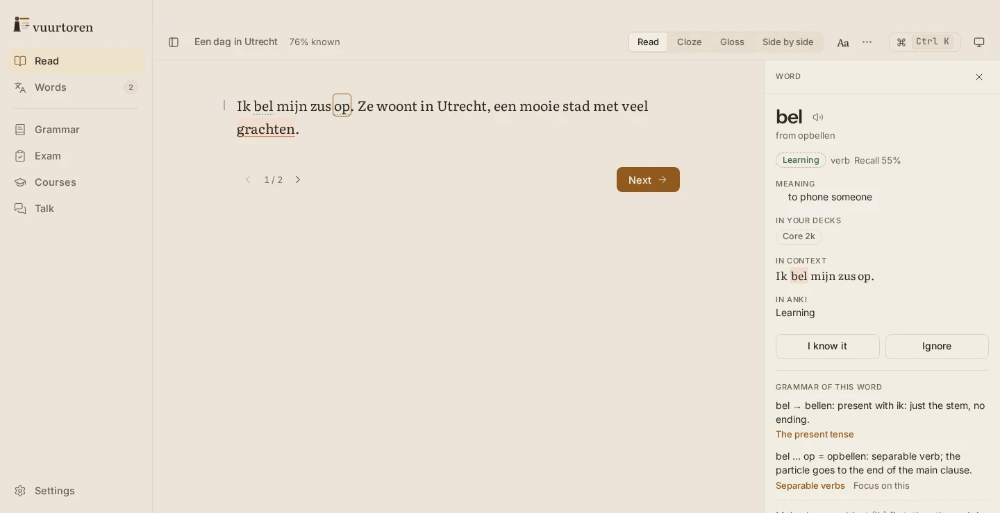
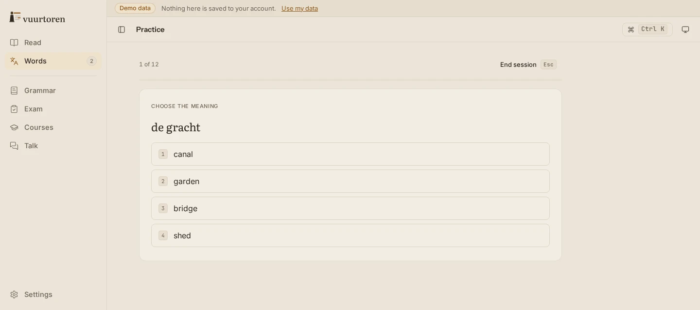
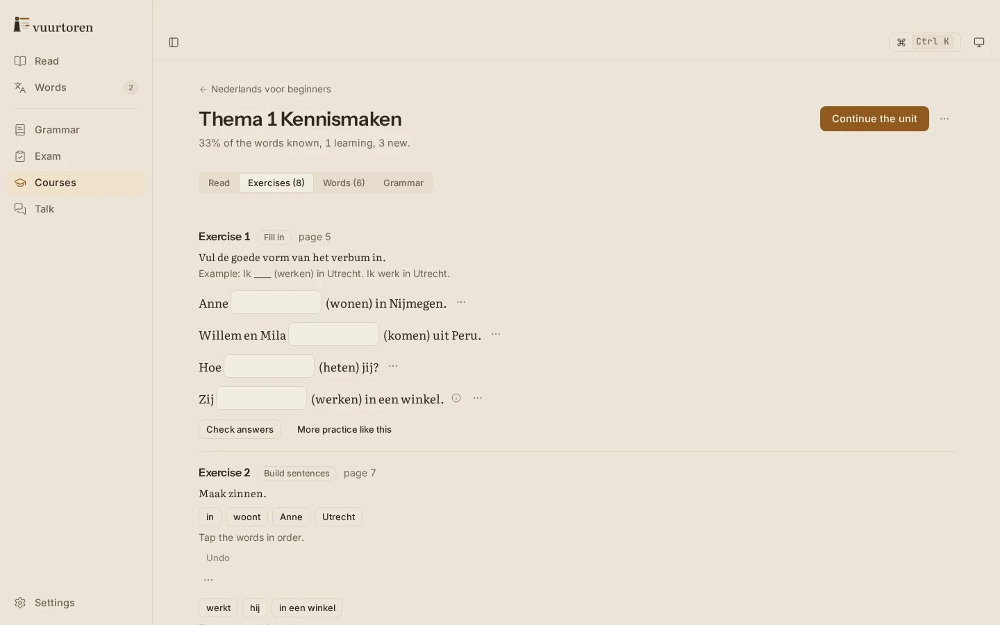
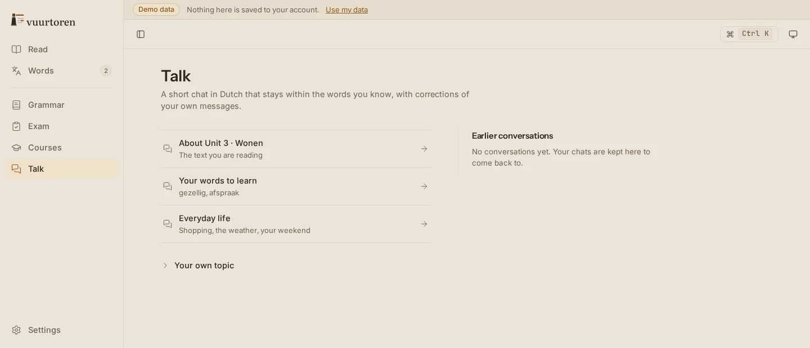

<p align="center">
  <picture>
    <source media="(prefers-color-scheme: dark)" srcset="docs/images/logo-dark.svg">
    <source media="(prefers-color-scheme: light)" srcset="docs/images/logo-light.svg">
    
  </picture>
</p>

<p align="center">
  <strong>Read Dutch with the words you already know.</strong><br>
  An open-source app for reading, flashcards and practice, built around the words you know.
</p>

<p align="center">
  <a href="https://github.com/pavlohrab/Kenning/actions/workflows/ci.yml"></a>
  <a href="https://github.com/pavlohrab/Kenning/actions/workflows/images.yml"></a>
  <a href="#licence"></a>
  <a href="deploy/README.md"></a>
  
  
</p>

<p align="center">
  <a href="#download">Download</a> ·
  <a href="#a-tour">Tour</a> ·
  <a href="#how-it-works">How it works</a> ·
  <a href="#self-hosting">Self-hosting</a> ·
  <a href="#sync">Sync</a> ·
  <a href="#development">Development</a>
</p>

<picture>
  <source media="(prefers-color-scheme: dark)" srcset="docs/images/home-dark.webp">
  <source media="(prefers-color-scheme: light)" srcset="docs/images/home-light.webp">
  
</picture>

Kenning turns any text (an article, a PDF, an EPUB, a photo of a page, your textbook) into
reading at your level. Words you know stay plain, a few words worth learning now are
highlighted, and the rest are glossed. Click a word to add it to your flashcards, with the
sentence you found it in.

### Why "Kenning"?

> Dutch _kennen_ is "to know" and _kennis_ is "knowledge"; English keeps the word in _ken_, as
> in "beyond my ken", the range of what you know. In Old Norse and Old English poetry a
> _kenning_ is a compound metaphor: "whale-road" for the sea, "word-hoard" for vocabulary.
> Dutch still thinks that way: its word for vocabulary is _woordenschat_, a "treasure of words".
> Kenning is about growing yours.

## What it does

- **Reading at your level.** Paste a text, a web address, a PDF, an EPUB or a photo. Read,
  Cloze and Gloss modes, and a set number of new words per page.
- **Flashcards.** Built-in cards with FSRS reviews, made from what you read.
- **Works with Anki.** Import an Anki deck file, export your cards as one, or keep studying in
  Anki and let Kenning read your decks.
- **Real Dutch analysis.** Separable verbs (_bel … op_ → _opbellen_), compounds, an offline
  dictionary and offline sentence translation.
- **Practice, grammar and exam.** Exercises on their own schedule, grammar topics from A1 to
  C1 with examples from your texts, and preparation for the A2 inburgeringsexamen.
- **Your textbook.** Import a course book you own and study it unit by unit.
- **AI if you want it.** Talk, stories and explanations with your own key. Everything else works
  without AI.
- **Private, on all your devices.** Your data stays on your device or your own server. Sync is
  encrypted with your passphrase.

## A tour

<table>
  <tr>
    <td width="50%" valign="top">
      <h3>Reader</h3>
      Pages of about 150 words. Amber marks the few words worth learning now; the grammar
      focus underlines one topic at a time. Click a word for its dictionary form, meaning,
      card and the grammar it takes part in, then add it to your words, study it first or
      mark it known.
    </td>
    <td width="50%" valign="top">
      <h3>Words</h3>
      Everything Kenning knows about your vocabulary. Filter by state or source (a text, a course unit, practice), open the same
      inspector, then add, practise or talk about a selection in bulk.
    </td>
  </tr>
  <tr>
    <td>
      <picture>
        <source media="(prefers-color-scheme: dark)" srcset="docs/images/reader-dark.webp">
        
      </picture>
    </td>
    <td>
      <picture>
        <source media="(prefers-color-scheme: dark)" srcset="docs/images/words-dark.webp">
        
      </picture>
    </td>
  </tr>
  <tr>
    <td width="50%" valign="top">
      <h3>Practice</h3>
      Meaning, cloze, de/het, separable verbs, perfect tense with hebben/zijn, forms, word order
      and dictation, each scheduled per word and skill with FSRS. Practice also counts
      as evidence that you are learning a word.
    </td>
    <td width="50%" valign="top">
      <h3>Courses</h3>
      Study along a textbook you own: import a PDF, EPUB or page photos, get the outline, each
      unit's texts and words matched to the words you know, and the book's exercises with checking.
    </td>
  </tr>
  <tr>
    <td>
      <picture>
        <source media="(prefers-color-scheme: dark)" srcset="docs/images/practice-dark.webp">
        
      </picture>
    </td>
    <td>
      <picture>
        <source media="(prefers-color-scheme: dark)" srcset="docs/images/courses-dark.webp">
        
      </picture>
    </td>
  </tr>
  <tr>
    <td width="50%" valign="top">
      <h3>Grammar</h3>
      A learning path of Dutch grammar topics from A1 to C1, each with an explanation, examples from your own
      texts (then Tatoeba), common mistakes and focused practice.
    </td>
    <td width="50%" valign="top">
      <h3>Exam</h3>
      The A2 inburgeringsexamen at a glance, with practice and timed mock exams for Lezen,
      Luisteren, Schrijven, Spreken and KNM, all original content.
    </td>
  </tr>
  <tr>
    <td>
      <picture>
        <source media="(prefers-color-scheme: dark)" srcset="docs/images/grammar-dark.webp">
        
      </picture>
    </td>
    <td>
      <picture>
        <source media="(prefers-color-scheme: dark)" srcset="docs/images/exam-dark.webp">
        
      </picture>
    </td>
  </tr>
  <tr>
    <td width="50%" valign="top">
      <h3>Library</h3>
      Your shelf of texts, with how much of each you already know, where you left off, and
      <b>Write a story</b> when an AI provider is set.
    </td>
    <td width="50%" valign="top">
      <h3>Talk <sup>optional AI</sup></h3>
      A short chat in Dutch that stays within the words you know, corrects your messages and
      offers new words to learn. Hidden until you add a provider.
    </td>
  </tr>
  <tr>
    <td>
      <picture>
        <source media="(prefers-color-scheme: dark)" srcset="docs/images/library-dark.webp">
        
      </picture>
    </td>
    <td>
      <picture>
        <source media="(prefers-color-scheme: dark)" srcset="docs/images/talk-dark.webp">
        
      </picture>
    </td>
  </tr>
</table>

<sub>Screenshots use the built-in demo data (<code>?demo</code>) and follow your GitHub theme.</sub>

## Download

Get Kenning for Windows, macOS or Linux from the
[latest release](https://github.com/pavlohrab/Kenning/releases/latest).

Step by step: **[Install](docs/guide/install.md)** · **[Self-host](docs/guide/self-host.md)** ·
**[Sync your devices](docs/guide/sync.md)**

## How it works

**Kenning knows your words.** Each word has a card, scheduled with FSRS. A word counts as known
when you are likely to recall it. If you use Anki, Kenning reads the same thing from your decks.

**Algorithms, not AI.** Texts are analysed by spaCy with rules for lemmas, separable verbs and
compounds. Meanings come from an offline Wiktionary dictionary, sentences are translated by an
offline model, and a planner picks which words to leave plain, introduce or blank. Practice is
scheduled with FSRS. Every rule and threshold: [docs/algorithms.md](docs/algorithms.md).

**AI is optional, with your own key**: Talk, explanations, stories at your level, extra example
sentences and exercises. Generated text is checked against your vocabulary before you see it.
Claude Code and Claude Desktop can connect over MCP. See [docs/ai.md](docs/ai.md).

**Private.** No telemetry, no third-party scripts. AI requests go straight from your device to
the provider you chose, and the key never leaves the device.

## Self-hosting

Run one Kenning for all your devices with Docker:

```sh
git clone https://github.com/pavlohrab/Kenning.git && cd Kenning
docker compose -f deploy/compose.yml up -d
```

Open <http://localhost:8080>. The short guide is [Self-host](docs/guide/self-host.md); every setting
is in [deploy/README.md](deploy/README.md).

## Sync

Keep your data the same on every device, locked with your passphrase. Sync through your own
Kenning server, a folder you already sync, WebDAV or a private GitHub repository. Kenning Cloud
is coming. See [Sync your devices](docs/guide/sync.md).

## Development

Node ≥ 22, pnpm, [uv](https://docs.astral.sh/uv/), Python ≥ 3.12.

```sh
pnpm install && pnpm build
cd server/nlp && uv run python scripts/build_dictionary.py && uv run python scripts/fetch_mt_model.py && cd -
pnpm nlp     # language server on :8000
pnpm dev     # web app on http://localhost:5173
```

`http://localhost:5173/?demo` runs with demo data. Desktop app:
`pnpm --filter @app/desktop tauri dev`.

Checks: `pnpm build && pnpm typecheck && pnpm lint && pnpm test`, and
`uv run ruff check && uv run pytest` in `server/nlp`.

Docs: [architecture](docs/architecture.md) · [algorithms](docs/algorithms.md) ·
[decisions](docs/decisions.md) · [design system](docs/design-system.md) ·
[roadmap](docs/roadmap.md).

Issues and pull requests are welcome. Contributions are dual-licensed as below.

## Licence

Kenning is dual-licensed under [MIT](LICENSE-MIT) or [Apache-2.0](LICENSE-APACHE), at your option.
Kenning is an independent project; it talks to Anki through the AnkiConnect add-on.
