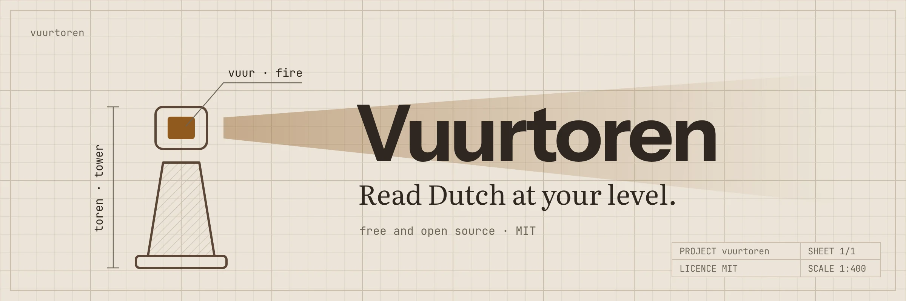

  <picture>
    <source media="(prefers-color-scheme: dark)" srcset="docs/images/banner-dark.webp">
    
  </picture>

  Vuurtoren helps you learn Dutch by reading. It translates the new words in any text, helps you
  learn them and explains the grammar as you read.

  
  
  
  

  <a href="https://vuurtoren.app">vuurtoren.app</a> ·
  <a href="https://vuurtoren.app/docs/quick-start.html">Quick start</a> ·
  <a href="https://vuurtoren.app/docs/install.html">Install</a> ·
  <a href="https://vuurtoren.app/docs/">Docs</a>

## Why I made it

While learning Dutch, I became frustrated that you usually either learn the words or read the
texts, but there is no easy way to integrate the two (one that doesn't involve proprietary data
formats and monthly subscriptions).

That's why I made Vuurtoren. It's free and open source.

Vuurtoren is Dutch for lighthouse: _vuur_, fire, on a _toren_, a tower. The name is a metaphor: the
app doesn't take you through the dark waters of Dutch, but it lights up the path and makes it easier
to find your way.

## What it does

**Read at your level.** You can read the stories that come with the app, or add your own text:
paste it, give a web address, or choose a PDF or a photo of a page. Every page is planned around the
words you know, and about three new words are left for you to learn. Tap any word to see what it
means in that sentence and the grammar around it, so you don't get stuck.

**Four ways to read.** There are four ways to read the same page: plain, with English above the
words you may not know, with some words you know turned into blanks, or side by side with the
English, where the same words have the same colour.

**Learn the words.** A word you tap while reading can become a card, with the sentence you found it
in. Every day a short review brings back the cards you're about to forget, scheduled with FSRS, the
algorithm [Anki](https://apps.ankiweb.net/) also offers. On a phone you just swipe. If you're
starting from zero, Vuurtoren comes with about 5000 of the most common Dutch words, and if you
already use Anki, you can bring your decks in or keep reviewing in Anki.

**Grammar in your texts.** Grammar like inversion, separable verbs or the perfect tense is marked
where it appears in your texts, and explained under each word. 63 topics from A1 to C1 explain it
with examples, following the e-ANS, the reference grammar of Dutch.

**Your textbook and the A2 exam.** Add your textbook as a PDF or photos of the pages, and read and
practise it unit by unit, with help for its exercises. Practice turns the words you're learning into
short exercises, and mock tests prepare you for the A2 inburgeringsexamen.

**Bring your own AI.** AI is only there if you want it, with your own key. It can explain a
sentence, write a story at your level, or chat with you in Dutch, keeping to the words you know and
correcting your mistakes. Vuurtoren checks what it writes against your words.

You can see it all on [vuurtoren.app](https://vuurtoren.app).

## Your data

Local-first, open source, with encrypted sync. Your words and texts stay on your devices and work
offline, with no account. When you sync, they're locked with your passphrase before they leave,
through your computer (for your phone, at home), your own server, WebDAV or a synced folder.
Vuurtoren Sync, where you just sign in, is planned.

How it all works, from the words you know to the help on each page, is on
[vuurtoren.app/how](https://vuurtoren.app/how.html), with the research behind it. The full
technical story is in [docs/dev](docs/dev/README.md).

## Support

Vuurtoren is free and made by one person. If it helps you, you can support it on
[bunq.me](https://bunq.me/vuurtorenapp) with iDEAL or a card, or on
[Ko-fi](https://ko-fi.com/pavlohrab) with PayPal.

## Licence

The code is MIT. The content in `content/` (the starter words and the stories) is CC BY-SA
4.0, because the dictionary and sentence sources it is built from are; see [content/LICENSE](content/LICENSE). Vuurtoren is an independent project, and it talks to Anki
through the AnkiConnect add-on.
