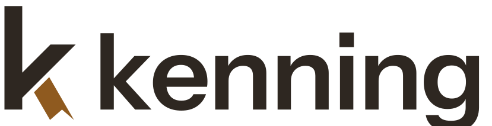
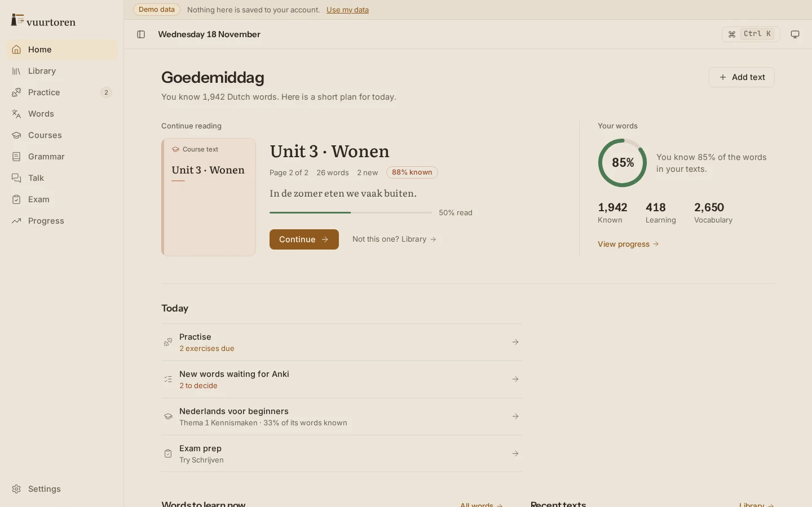
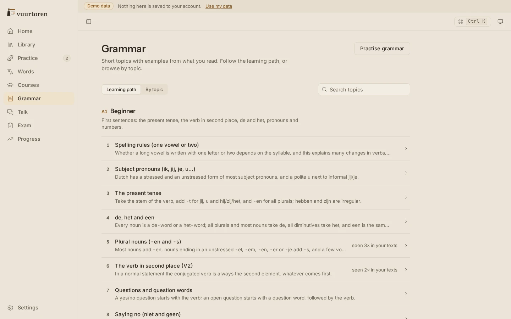
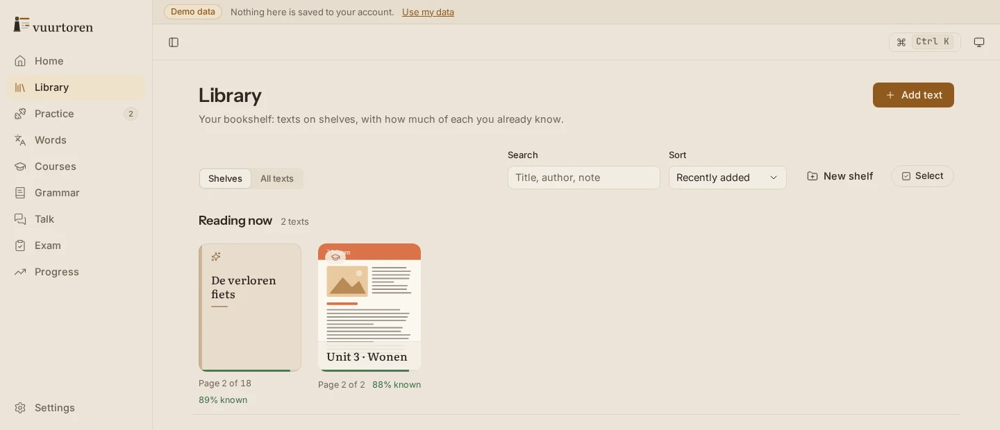

<p align="center">
  <picture>
    <source media="(prefers-color-scheme: dark)" srcset="docs/images/logo-dark.svg">
    <source media="(prefers-color-scheme: light)" srcset="docs/images/logo-light.svg">
    
  </picture>
</p>

<p align="center">
  <strong>Read Dutch with the words you already know.</strong><br>
  An open-source reader that uses your Anki decks as the record of your vocabulary.
</p>

<p align="center">
  <a href="https://github.com/pavlohrab/Kenning/actions/workflows/ci.yml"></a>
  <a href="https://github.com/pavlohrab/Kenning/actions/workflows/images.yml"></a>
  <a href="#licence"></a>
  <a href="deploy/README.md"></a>
  
  
</p>

<p align="center">
  <a href="#download">Download</a> ·
  <a href="#a-tour">Tour</a> ·
  <a href="#how-it-works">How it works</a> ·
  <a href="#self-hosting">Self-hosting</a> ·
  <a href="#development">Development</a>
</p>

<picture>
  <source media="(prefers-color-scheme: dark)" srcset="docs/images/home-dark.webp">
  <source media="(prefers-color-scheme: light)" srcset="docs/images/home-light.webp">
  
</picture>

You already study Dutch words in Anki. Kenning reads your decks, works out which words you
really know, and turns any text (an article, a PDF, a photo of a page, your textbook) into
reading at the right level: words you know stay plain, a few words worth learning now are
highlighted, and the rest are glossed. When you meet a word you want, one click sends it back
to Anki with the sentence you found it in.

### Why "Kenning"?

> Dutch _kennen_ is "to know" and _kennis_ is "knowledge"; English keeps the word in _ken_, as
> in "beyond my ken", the range of what you know. In Old Norse and Old English poetry a
> _kenning_ is a compound metaphor: "whale-road" for the sea, "word-hoard" for vocabulary.
> Dutch still thinks that way: its word for vocabulary is _woordenschat_, a "treasure of words".
> Kenning is about growing yours.

## Highlights

- **Anki is optional.** Kenning can hold your cards and run your reviews itself, or work with
  your Anki decks.
- **Your Anki decks are the source of truth.** Dutch decks and fields are found automatically;
  each card's interval (SM-2) or stability (FSRS) becomes a recall probability.
- **Graded reading of your own texts.** Paste, a web address, a PDF, an EPUB or a photo.
  Read, Cloze and Gloss modes, an exact new-words budget per page, and cloze hints.
- **Real Dutch analysis.** spaCy plus rules for separable verbs (_bel … op_ → _opbellen_),
  derivations and compounds glossed from their parts, an offline Wiktionary dictionary and offline sentence
  translation.
- **Practice, grammar, exam.** Exercises without AI on their own FSRS schedule, grammar topic
  pages (A1–C1) with examples from what you read, and preparation for the A2 inburgeringsexamen.
- **Study along your textbook.** Import the course book you own; units, word lists and
  exercises are found and matched to your decks.
- **No AI needed; bring your own key if you want it.** Talk, stories and explanations are
  optional extras with Anthropic, any OpenAI-compatible provider, or a local model.
- **Private.** Your data is one SQLite file on your computer or your own server. Kenning writes
  to Anki only when you click.

## A tour

<table>
  <tr>
    <td width="50%" valign="top">
      <h3>Reader</h3>
      Pages of about 150 words. Amber marks the few words worth learning now; the grammar
      focus underlines one topic at a time. Click a word for its dictionary form, meaning,
      decks, live Anki state and the grammar it takes part in, then <b>Add to Anki</b>,
      <b>Study first in Anki</b> or <b>Mark known</b>.
    </td>
    <td width="50%" valign="top">
      <h3>Words</h3>
      The hub for everything Kenning knows about your vocabulary, from Anki and from your
      reading. Filter by state or source (a text, a course unit, practice), open the same
      inspector, then add, practise or talk about a selection in bulk.
    </td>
  </tr>
  <tr>
    <td>
      <picture>
        <source media="(prefers-color-scheme: dark)" srcset="docs/images/reader-dark.webp">
        
      </picture>
    </td>
    <td>
      <picture>
        <source media="(prefers-color-scheme: dark)" srcset="docs/images/words-dark.webp">
        
      </picture>
    </td>
  </tr>
  <tr>
    <td width="50%" valign="top">
      <h3>Practice</h3>
      Meaning, cloze, de/het, separable verbs, perfect tense with hebben/zijn, forms, word order
      and dictation, each scheduled per word and skill with FSRS. Practice never writes to
      Anki; it counts as evidence that you are learning a word.
    </td>
    <td width="50%" valign="top">
      <h3>Courses</h3>
      Study along a textbook you own: import a PDF, EPUB or page photos, get the outline, each
      unit's texts and words matched to your Anki decks, and the book's exercises with checking.
    </td>
  </tr>
  <tr>
    <td>
      <picture>
        <source media="(prefers-color-scheme: dark)" srcset="docs/images/practice-dark.webp">
        
      </picture>
    </td>
    <td>
      <picture>
        <source media="(prefers-color-scheme: dark)" srcset="docs/images/courses-dark.webp">
        
      </picture>
    </td>
  </tr>
  <tr>
    <td width="50%" valign="top">
      <h3>Grammar</h3>
      A learning path of Dutch grammar topics from A1 to C1, each with an explanation, examples from your own
      texts (then Tatoeba), common mistakes and focused practice.
    </td>
    <td width="50%" valign="top">
      <h3>Exam</h3>
      The A2 inburgeringsexamen at a glance, with practice and timed mock exams for Lezen,
      Luisteren, Schrijven, Spreken and KNM, all original content.
    </td>
  </tr>
  <tr>
    <td>
      <picture>
        <source media="(prefers-color-scheme: dark)" srcset="docs/images/grammar-dark.webp">
        
      </picture>
    </td>
    <td>
      <picture>
        <source media="(prefers-color-scheme: dark)" srcset="docs/images/exam-dark.webp">
        
      </picture>
    </td>
  </tr>
  <tr>
    <td width="50%" valign="top">
      <h3>Library</h3>
      Your shelf of texts, with how much of each you already know, where you left off, and
      <b>Create a story</b> when an AI provider is set.
    </td>
    <td width="50%" valign="top">
      <h3>Talk <sup>optional AI</sup></h3>
      A short chat in Dutch that stays within the words you know, corrects your messages and
      offers new words for Anki. Hidden until you add a provider.
    </td>
  </tr>
  <tr>
    <td>
      <picture>
        <source media="(prefers-color-scheme: dark)" srcset="docs/images/library-dark.webp">
        
      </picture>
    </td>
    <td>
      <picture>
        <source media="(prefers-color-scheme: dark)" srcset="docs/images/talk-dark.webp">
        
      </picture>
    </td>
  </tr>
</table>

<sub>Screenshots use the built-in demo data (<code>?demo</code>) and follow your GitHub theme.</sub>

## Download

| System  | File                                                                                 |
| ------- | ------------------------------------------------------------------------------------ |
| Windows | [`.exe` installer](https://github.com/pavlohrab/Kenning/releases/latest)             |
| Linux   | [`.AppImage` or `.deb`](https://github.com/pavlohrab/Kenning/releases/latest)        |
| macOS   | [`.dmg` (Apple chip or Intel)](https://github.com/pavlohrab/Kenning/releases/latest) |

Open it, keep Anki open with [AnkiConnect](https://ankiweb.net/shared/info/2055492159) (add-on
code `2055492159`), done. The `Kenning_offline_…` files include the Dutch data, for a computer
without internet.

The apps are not signed yet. **Windows:** click **More info → Run anyway**. **macOS:** right-click
the app → **Open**. **AppImage:** make it executable (`chmod +x`), then run it.

## How it works

**Anki is the record of what you know.** Kenning reads your Dutch decks and turns each card into a
recall probability (SM-2 or FSRS). A word counts as known at an interval of 21 days or more with
recall of at least 0.6. Answers you give in Kenning add evidence but never make a word known; only
Anki or **Mark known** does that.

**Algorithms, not AI.** Texts are analysed by spaCy with rules for lemmas, separable verbs and
compounds. Meanings come from an offline Wiktionary dictionary, sentences are translated by an
offline model, and a planner picks which words to leave plain, introduce or blank. Practice is
scheduled with FSRS. Every rule and threshold: [docs/algorithms.md](docs/algorithms.md).

**AI is optional, with your own key**: Talk, explanations, stories at your level, extra example
sentences and exercises. Generated text is checked against your vocabulary before you see it.
Claude Code and Claude Desktop can connect over MCP. See [docs/ai.md](docs/ai.md).

**Private.** No telemetry, no third-party scripts. AI requests go straight from your device to
the provider you chose, and the key never leaves the device.

## Self-hosting

For one Kenning shared by all your devices:

```sh
git clone https://github.com/pavlohrab/Kenning.git && cd Kenning
docker compose -f deploy/compose.yml up -d
```

Open <http://localhost:8080>. HTTPS, sign-in, Dockge + Cloudflare Tunnel, updates and backups:
[deploy/README.md](deploy/README.md).

## Development

Node ≥ 22, pnpm, [uv](https://docs.astral.sh/uv/), Python ≥ 3.12.

```sh
pnpm install && pnpm build
cd server/nlp && uv run python scripts/build_dictionary.py && uv run python scripts/fetch_mt_model.py && cd -
pnpm nlp     # language server on :8000
pnpm dev     # web app on http://localhost:5173
```

`http://localhost:5173/?demo` runs with demo data and no Anki. Desktop app:
`pnpm --filter @app/desktop tauri dev`.

Checks: `pnpm build && pnpm typecheck && pnpm lint && pnpm test`, and
`uv run ruff check && uv run pytest` in `server/nlp`.

Docs: [architecture](docs/architecture.md) · [algorithms](docs/algorithms.md) ·
[decisions](docs/decisions.md) · [design system](docs/design-system.md) ·
[roadmap](docs/roadmap.md).

Issues and pull requests are welcome. Contributions are dual-licensed as below.

## Licence

Kenning is dual-licensed under [MIT](LICENSE-MIT) or [Apache-2.0](LICENSE-APACHE), at your option.
Kenning is an independent project; it talks to Anki through the AnkiConnect add-on.
