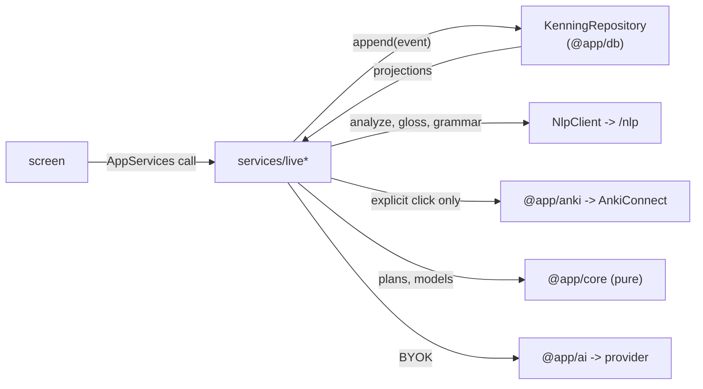

# Architecture

A short map of the code as it is now: which package owns what, how a click reaches the data,
and where to put new code. The why is in the [ADRs](adr/); the algorithms are in
[algorithms.md](algorithms.md).

## Packages

Dependencies point down; nothing in `packages/` imports from `apps/`.

| Package               | Owns                                                                                                                                                                                 | Depends on                            |
| --------------------- | ------------------------------------------------------------------------------------------------------------------------------------------------------------------------------------ | ------------------------------------- |
| `packages/core`       | Pure domain logic: learner model and evidence, token matching, reading planner and staircase, practice engine and FSRS, courses, language profile, the `InspectorEntry` DTO. No I/O. | —                                     |
| `packages/content`    | Grammar topics and exam content (Markdown, generated and validated at build).                                                                                                        | —                                     |
| `packages/db`         | The append-only event log, projections and the `KenningRepository` API; drivers for browser SQLite (OPFS worker), Node and HTTP (server mode).                                       | core                                  |
| `packages/anki`       | AnkiConnect client, deck detection, snapshots, and the one command layer for Anki writes (add, study first, mark known; ADR 0007).                                                   | core                                  |
| `packages/nlp-client` | HTTP client of `server/nlp` and the cached practice-data source.                                                                                                                     | —                                     |
| `packages/ai`         | Bring-your-own-key providers, prompts, story / sentence / exam generators and their checks, the per-device key store.                                                                | core                                  |
| `packages/ui`         | Design-system components (reader, word inspector, cards, controls). Renders DTOs from core; no services.                                                                             | core                                  |
| `packages/mcp-tools`  | The MCP tools shared by `apps/mcp` (stdio) and `server/api` (HTTP).                                                                                                                  | core, content, db, ai                 |
| `apps/web`            | The React PWA.                                                                                                                                                                       | all of the above                      |
| `apps/mcp`            | stdio MCP server.                                                                                                                                                                    | mcp-tools, core, db, anki, nlp-client |
| `server/api`          | Server storage mode: sign-in, one SQLite file behind RPC, HTTP MCP.                                                                                                                  | mcp-tools, core, db, nlp-client       |
| `server/nlp`          | Python language server: analysis (spaCy), dictionary, forms, sentences, grammar detectors, OCR, translation.                                                                         | —                                     |

## apps/web

```
src/
  main.tsx            boot: demo / server mode / browser mode -> AppServices
  router.tsx          routes (lazy screens)
  shell/              app shell, PageHeader, degraded indicator, sign-in, storage screens
  screens/            one folder per area where it has several files:
    courses/ exam/ grammar/ onboarding/ reader/ settings/ words/
    Home, Library, Import, ReaderPage, Practice, Progress, Converse, ...
  services/           everything the screens call (AppServices), see below
  storage/            startup mode, tab lock, local.ts (localStorage helpers)
  practice/           practice engine glue (core generators, speech)
  format.ts           pct, plural, formatBytes
```

Screens only talk to `AppServices` (`services/types.ts`) through `useServices()`. They never
import `@app/db`, `@app/anki` or `@app/nlp-client` directly.

### Services

`createLiveServices(repo, { remoteChanged?, platform? })` in `services/live.ts` is the
composition root. Each domain module gets only what it needs:

| Module              | Domain                                                                                                            |
| ------------------- | ----------------------------------------------------------------------------------------------------------------- |
| `platform.ts`       | `Platform`: `fetch` and device storage (review A20); `browserPlatform()` by default.                              |
| `liveSettings.ts`   | Settings (secrets in device storage), the NLP and AnkiConnect clients, Anki connection status.                    |
| `liveLearner.ts`    | Learner-model and staircase cache with a version counter (`changed()` makes plans stale).                         |
| `liveDictionary.ts` | Glosses (card gloss, then Wiktionary), sentence translation, both cached.                                         |
| `liveTexts.ts`      | Import, analysis, Library list, reading plans, lookups, cloze answers, finished segments.                         |
| `liveWords.ts`      | Inspector entry, words of a text, word actions, Anki sync, Words list, suggestions.                               |
| `liveProfile.ts`    | Language profile, deck choices, Anki snapshot of the profile's sources.                                           |
| `livePractice.ts`   | Practice sessions, answers, `buildWordData` (shared with courses).                                                |
| `liveGrammar.ts`    | Grammar hits of a text, topic overview and examples.                                                              |
| `liveAI.ts`         | AI config and keys, stories, conversations, AI sentences, exam items.                                             |
| `liveExam.ts`       | Exam attempts.                                                                                                    |
| `liveCourses.ts`    | Composition of `courses/`: `context` (shared lookups), `import`, `packs`, `views`, `anki`, `practice`, `grammar`. |

`mock*.ts` implement the same `AppServices` for `?demo` and for most screen tests (review A6:
replacing them with the live services over a seeded repository is still open).

## Data flow



- **Writes** are events appended to the log (`TextImported`, `NoteAdded`, `ExerciseAnswered`,
  ...). Projections in `@app/db` turn them into tables; nothing writes a table directly.
- **Reads** go through repository queries; the services cache what is expensive (learner model,
  reading plans, glosses) and drop the caches on `changed()` or when another device wrote
  (server mode, `checkRemoteChanges`).
- **Anki** is read for snapshots and live card state; it is written only by the commands in
  `@app/anki` (ADR 0007), each of which also records its event.
- **Degraded modes** (NLP, Anki, AI, translation, storage) report to one signal
  (`services/degraded.ts`) shown in the top bar.

## Language server data packs (D1)

The NLP image holds code and libraries only; its data are versioned **data packs** on the
`/data` volume (`server/nlp/src/kenning_nlp/packs.py`, manifest `packs.json` next to it):

| pack                  | contents                               | archive | installed |
| --------------------- | -------------------------------------- | ------- | --------- |
| `dictionary-nl`       | Wiktionary (Kaikki) glosses, forms     | 14 MB   | 39 MB     |
| `sentences-nl`        | Tatoeba sentences + lemma index        | 20 MB   | 47 MB     |
| `mt-nl-en`            | OPUS-MT nl→en, CTranslate2 int8        | 70 MB   | 84 MB     |
| `grammar-examples-nl` | derived: built on the server (< 2 min) | —       | 0.4 MB    |

- **Manifest**: `{name: {version, sha256, size}}`; the archive is `<name>-<version>.tar.gz`
  (deterministic tar.gz of one file or directory). A marker `<data>.pack.json` records what is
  installed (version, digest, source).
- **Install** (at startup in a background thread, and on `POST /nlp/admin/packs`): each missing
  or outdated pack comes from `KENNING_PACKS_DIR` (bundled archives: the `-full` image, the
  desktop sidecar), else `KENNING_PACKS_URL` (release assets; optional `KENNING_PACKS_TOKEN`),
  else, with `KENNING_PACKS=auto`, a local build from the pinned upstream sources with
  `scripts/`. Archives are size- and SHA-256-checked, unpacked next to the target and renamed into
  place; caches holding the old data are dropped. Data without a marker (a development build) is
  never replaced unless forced. Works offline once installed. `GET /health` shows
  `packs.items.<name>.state` (`ok`, `outdated`, `unversioned`, `missing`) and `activity`.
- **Releasing new data**: bump the pack's version in `packs.json`, run
  `uv run python scripts/build_packs.py --out dist/packs`, upload `dist/packs/*` as assets of a
  `packs-<version>` release (the `packs` workflow does both) and commit the updated `packs.json`.
  The repository is private for now, so `KENNING_PACKS_URL` has no default: set it to wherever the
  archives are reachable, or let the server build them.
- **Analyzer version** (review A4): `GET /health` and every `/analyze/text` result carry
  `analyzerVersion` (hash of the spaCy/model/library versions, the token-shaping modules, the
  grammar detectors and the installed dictionary pack). `TextAnalyzed` events store it
  (`text_tokens.analyzer_version`); the reader re-analyses a text stored with another version once,
  in the background, when it is opened, and the projection drops that text's grammar hits.

## Checks

- `pnpm build && pnpm typecheck && pnpm lint && pnpm test && pnpm format:check`
- `pnpm e2e`: Playwright smoke test (`apps/web/e2e`) of import, reader, inspector, text size and
  practice, in demo and browser-storage mode, with the language server and AnkiConnect faked.
- `pnpm knip`: unused files, exports and dependencies.
- `npx madge@8.0.0 --circular --extensions ts,tsx <package>/src`: no import cycles (all clean).
- `server/nlp`: `uv run ruff check && uv run ruff format --check && uv run pytest -q`.
