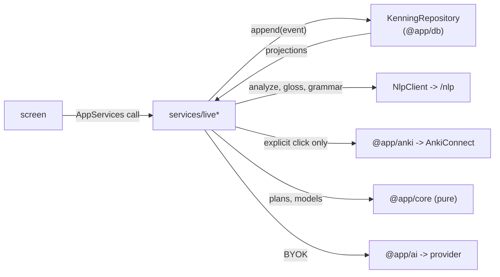

# Architecture

Which package owns what and how a click reaches the data. Rules: [decisions.md](decisions.md).
Algorithms: [algorithms.md](algorithms.md).

## Packages

Dependencies point down; nothing in `packages/` imports from `apps/`.

| Package               | Owns                                                                                                                                                                                                                                                                    | Depends on                            |
| --------------------- | ----------------------------------------------------------------------------------------------------------------------------------------------------------------------------------------------------------------------------------------------------------------------- | ------------------------------------- |
| `packages/core`       | Pure domain logic: learner model and evidence, token matching, reading planner and staircase, practice engine and FSRS, the native scheduler (FSRS-6, replay, card templates, training data), courses, language profile and its mode, the `InspectorEntry` DTO. No I/O. | —                                     |
| `packages/content`    | Grammar topics and exam content (Markdown, generated and validated at build).                                                                                                                                                                                           | —                                     |
| `packages/db`         | The append-only event log, projections (native cards included) and the `KenningRepository` API; drivers for browser SQLite (OPFS worker), Node and HTTP (server mode); sync (`sync/`: encryption, the sync engine, the store interface).                                | core                                  |
| `packages/anki`       | AnkiConnect client, deck detection, snapshots, package files (.apkg, .colpkg) and decks read through AnkiConnect turned into native cards, and the one command layer for word actions in both modes (add, study first, mark known).                                     | core                                  |
| `packages/nlp-client` | HTTP client of `server/nlp` and the cached practice-data source.                                                                                                                                                                                                        | —                                     |
| `packages/ai`         | Bring-your-own-key providers, prompts, story / sentence / exam generators and their checks, the per-device key store.                                                                                                                                                   | core                                  |
| `packages/ui`         | Design-system components (reader, word inspector, cards, controls). Renders DTOs from core; no services.                                                                                                                                                                | core                                  |
| `packages/mcp-tools`  | The MCP tools shared by `apps/mcp` (stdio) and `server/api` (HTTP).                                                                                                                                                                                                     | core, content, db, ai                 |
| `apps/web`            | The React PWA.                                                                                                                                                                                                                                                          | all of the above                      |
| `apps/desktop`        | Tauri v2 desktop app: local SQLite file, bundled language server, Anki bridge, sync folder and sync requests, key store, updater.                                                                                                                                       | (loads apps/web)                      |
| `apps/mcp`            | stdio MCP server.                                                                                                                                                                                                                                                       | mcp-tools, core, db, anki, nlp-client |
| `server/api`          | Server storage mode: sign-in, one SQLite file behind RPC, HTTP MCP, sync place (`/api/sync`) and sync tokens.                                                                                                                                                           | mcp-tools, core, db, nlp-client       |
| `server/nlp`          | Python language server: analysis (spaCy), dictionary, forms, sentences, grammar detectors, OCR (RapidOCR, Tesseract), translation.                                                                                                                                      | —                                     |

## apps/web

```
src/
  main.tsx            boot: demo / server mode / browser mode -> AppServices
  router.tsx          routes (lazy screens)
  shell/              app shell, PageHeader, degraded indicator, sign-in, storage screens
  screens/            one folder per area where it has several files:
    courses/ exam/ grammar/ onboarding/ reader/ review/ settings/ words/
    Home, Library, Import, ReaderPage, Practice, Progress, Converse, ...
  services/           everything the screens call (AppServices), see below
  storage/            startup mode, tab lock, local.ts (localStorage helpers)
  auth/               sign-in client, MCP and sync tokens of a Kenning server
  desktop/            the desktop app's bridge, setup, data file and lock screens
  sync/               sync places (server, WebDAV, GitHub, folder) and the key store
  pwa/                service worker registration, update prompt, install button
  practice/           practice engine glue (core generators, speech)
  exam/               exam timer and helpers
  native/             workers: the FSRS optimizer (WebAssembly) and SQLite for package files
  format.ts           pct, plural, formatBytes, relativeTime
```

Screens only talk to `AppServices` (`services/types.ts`) through `useServices()`. They never
import `@app/db`, `@app/anki` or `@app/nlp-client` directly.

The service worker is `apps/web/sw/sw.js`, filled in and emitted as `/sw.js` by the
`kenning-sw` plugin in `vite.config.ts` (built app only): it precaches the app shell (scripts,
styles, SQLite wasm, latin fonts, icons, `offline.html`), answers navigations network first
(offline: the cached shell), and never touches `/api`, `/nlp`, `/anki` or other origins.

### Services

`createLiveServices(repo, { remoteChanged?, platform? })` in `services/live.ts` is the
composition root. Each domain module gets only what it needs:

| Module              | Domain                                                                                                            |
| ------------------- | ----------------------------------------------------------------------------------------------------------------- |
| `platform.ts`       | `Platform`: `fetch` and device storage; `browserPlatform()` by default.                                           |
| `liveSettings.ts`   | Settings (secrets in device storage), the NLP and AnkiConnect clients, Anki connection status.                    |
| `liveLearner.ts`    | Learner-model and staircase cache with a version counter (`changed()` makes plans stale).                         |
| `liveDictionary.ts` | Glosses (card gloss, then Wiktionary), sentence translation, word meanings in the sentence, cached.               |
| `liveTexts.ts`      | Import, analysis, Library list, reading plans, lookups, cloze answers, finished segments.                         |
| `liveWords.ts`      | Inspector entry, words of a text, word actions, Anki sync, Words list, suggestions.                               |
| `liveProfile.ts`    | Language profile, deck choices, Anki snapshot of the profile's sources.                                           |
| `livePractice.ts`   | Practice sessions, answers, `buildWordData` (shared with courses).                                                |
| `liveGrammar.ts`    | Grammar hits of a text, topic overview and examples.                                                              |
| `liveAI.ts`         | AI config and keys, stories, conversations, AI sentences, exam items.                                             |
| `liveExam.ts`       | Exam attempts.                                                                                                    |
| `liveNative.ts`     | Native mode: review queue, answers and undo, deck options, package import, the move from Anki, FSRS tuning.       |
| `liveSync.ts`       | Sync: the place, its credentials and the key on this device; one sync at a time; syncs by itself once a minute.   |
| `liveCourses.ts`    | Composition of `courses/`: `context` (shared lookups), `import`, `packs`, `views`, `anki`, `practice`, `grammar`. |

`mock*.ts` implement the same `AppServices` for `?demo` and for screen tests.

## Data flow



- **Writes** are events appended to the log (`TextImported`, `NoteAdded`, `ExerciseAnswered`,
  ...). Projections in `@app/db` turn them into tables; nothing writes a table directly, except
  the analysis cache below.
- **Analysis cache.** Tokens and grammar hits from the language server are derived data:
  `saveTextAnalysis` and `saveTextGrammar` write them to `text_tokens` and `text_grammar` on
  this device (in server mode, on the server through `/api/rpc`), never as events, so sync
  never carries them. One row per text, valid for its content hash and analyzer version;
  `analyzed_at` keeps a replayed `TextAnalyzed` event from an older log from overwriting a newer
  analysis. Rebuilds keep the cache; a text without an analysis is analysed when opened.
- **Reads** go through repository queries; the services cache what is expensive (learner model,
  reading plans, glosses) and drop the caches on `changed()` or when another device wrote
  (server mode, `checkRemoteChanges`).
- **Modes.** The language profile's mode decides who holds the cards. Connected: Anki is read
  for snapshots and live card state and written only by the commands in `@app/anki`, each of
  which also records its event. Native: the cards are events and projections in `@app/db`
  (`NativeNotesAdded`, `CardReviewed`, `CardReviewUndone`, `NativeCardsChanged`,
  `NativeDeckOptionsSet`, `FsrsParamsSet`); the learner model reads them in place of the Anki
  snapshot, and the same commands act on them. Anki is only read, by the move from Anki.
- **Native reviews** are scheduled on the device (`@app/core` native scheduler). The FSRS
  optimizer runs in a worker as WebAssembly; a package file's SQLite collection is opened in
  another worker. Both work offline, in the browser and in the desktop app.
- **Degraded modes** (NLP, Anki, AI, translation, storage) report to one signal
  (`services/degraded.ts`) shown in the top bar.

## Language server OCR

`POST /ocr` (one upload) and `POST /course/ocr` (a whole book, as a background job) share one
pipeline in `server/nlp`: PDF pages keep a usable text layer (`pdf.py`), other pages are
cleaned up (`straighten.py`: page found in a photo, flattened, deskewed, dewarped) and read by
RapidOCR (`rapid.py`, PaddleOCR models on ONNX Runtime), or by Tesseract for Ukrainian and when
RapidOCR is not installed (`ocr.py`). Both engines produce words with boxes and confidences, from
which the text, the layout blocks and the review flags (`ocr_review.py`) are built.
RapidOCR and its models come with the `ocr` extra of the Python package: the standard image and
the desktop sidecar have it (about 280 MB installed, 120 MB compressed: OpenCV 170 MB, ONNX
Runtime 73 MB, models 32 MB), the `-slim` image has no OCR. `GET /health` reports `ocr` and
`ocrEngine`; the web app shows photo import when `ocr` is true.

## Language server data packs

The NLP image holds code and libraries only; its data are versioned **data packs** on the
`/data` volume (`server/nlp/src/kenning_nlp/packs.py`, manifest `packs.json` next to it):

| pack                  | contents                              | archive | installed |
| --------------------- | ------------------------------------- | ------- | --------- |
| `dictionary-nl`       | Wiktionary (Kaikki) glosses, forms    | 14 MB   | 39 MB     |
| `sentences-nl`        | Tatoeba sentences + lemma index       | 20 MB   | 47 MB     |
| `mt-nl-en`            | OPUS-MT nl→en, CTranslate2 int8       | 70 MB   | 84 MB     |
| `grammar-examples-nl` | derived: built on the server (~3 min) | —       | 0.4 MB    |

- **Manifest**: `{name: {version, sha256, size}}`; the archive is `<name>-<version>.tar.gz`
  (deterministic tar.gz of one file or directory). A marker `<data>.pack.json` records what is
  installed (version, digest, source).
- **Install** (at startup in a background thread, and on `POST /nlp/admin/packs`): each missing
  or outdated pack comes from `KENNING_PACKS_DIR` (bundled archives: the `-full` image, the
  desktop sidecar), else `KENNING_PACKS_URL` (release assets; optional `KENNING_PACKS_TOKEN`),
  else, with `KENNING_PACKS=auto`, a local build from the pinned upstream sources with
  `scripts/`. Archives are size- and SHA-256-checked, unpacked next to the target and renamed into
  place; caches holding the old data are dropped. Data without a marker (a development build) is
  never replaced unless forced. Works offline once installed. `GET /health` shows
  `packs.items.<name>.state` (`ok`, `outdated`, `unversioned`, `missing`) and `activity`.
- **Releasing new data**: bump the pack's version in `packs.json`, run
  `uv run python scripts/build_packs.py --out dist/packs`, upload `dist/packs/*` as assets of a
  `packs-<version>` release (the `packs` workflow does both) and commit the updated `packs.json`.
  By default the server downloads them from this repository's GitHub releases.
- **Analyzer version**: `GET /health` and every `/analyze/text` result carry
  `analyzerVersion` (hash of the spaCy/model/library versions, the token-shaping modules, the
  grammar detectors and the installed dictionary pack). The analysis cache stores it
  (`text_tokens.analyzer_version`), and the repository records when each version first appeared
  on the device (`analyzerSeen`). The reader re-analyses a text once, in the background, when
  it is opened and its analysis is older than the device's analyzer; another device's analysis
  from an old log, or an older analyzer brought back, is kept. A new analyzer version drops the
  text's grammar hits.

## Checks

- `pnpm build && pnpm typecheck && pnpm lint && pnpm test && pnpm format:check`
- `pnpm e2e`: Playwright smoke test (`apps/web/e2e`) of import, reader, inspector, text size and
  practice, in demo and browser-storage mode, with the language server and AnkiConnect faked.
- `pnpm knip`: unused files, exports and dependencies.
- `npx madge@8.0.0 --circular --extensions ts,tsx <package>/src`: no import cycles.
- `server/nlp`: `uv run ruff check && uv run ruff format --check && uv run pytest -q`.
