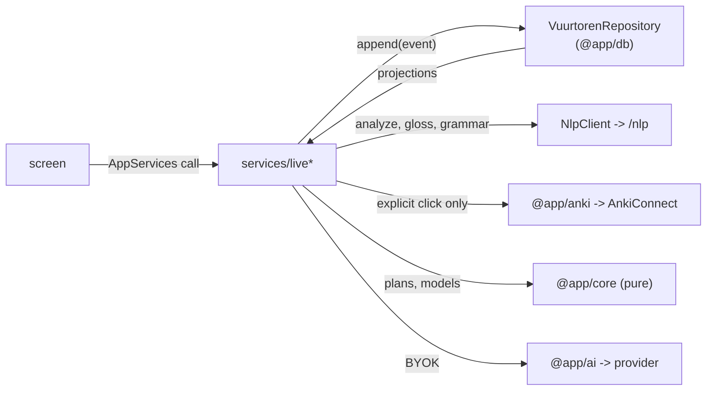

# Architecture

This page says which package owns what, and how a click in the app reaches the data. How the
algorithms themselves work is in [algorithms.md](algorithms.md).

## Packages

The code is split into packages and apps. Dependencies point down the table, and nothing in
`packages/` imports from `apps/`.

| Package               | Owns                                                                                                                                                                                                                                                                    | Depends on                            |
| --------------------- | ----------------------------------------------------------------------------------------------------------------------------------------------------------------------------------------------------------------------------------------------------------------------- | ------------------------------------- |
| `packages/core`       | Pure domain logic: learner model and evidence, token matching, reading planner and staircase, practice engine and FSRS, the native scheduler (FSRS-6, replay, card templates, training data), courses, language profile and its mode, the `InspectorEntry` DTO. No I/O. | —                                     |
| `packages/content`    | Grammar topics and exam content (Markdown, generated and validated at build).                                                                                                                                                                                           | —                                     |
| `packages/db`         | The append-only event log, projections (native cards included) and the `VuurtorenRepository` API; drivers for browser SQLite (OPFS worker), Node and the desktop app's file; sync (`sync/`: encryption, the sync engine, the store interface).                          | core                                  |
| `packages/anki`       | AnkiConnect client, deck detection, snapshots, package files (.apkg, .colpkg) and decks read through AnkiConnect turned into native cards, and the one command layer for word actions in both modes (add, study first, mark known).                                     | core                                  |
| `packages/nlp-client` | HTTP client of `server/nlp` and the cached practice-data source.                                                                                                                                                                                                        | —                                     |
| `packages/ai`         | Bring-your-own-key providers, prompts, story / sentence / exam generators and their checks, the per-device key store.                                                                                                                                                   | core                                  |
| `packages/ui`         | Design-system components (reader, word inspector, cards, controls). Renders DTOs from core; no services.                                                                                                                                                                | core                                  |
| `packages/mcp-tools`  | The MCP tools of `apps/mcp`.                                                                                                                                                                                                                                            | core, content, db, ai                 |
| `apps/web`            | The React PWA.                                                                                                                                                                                                                                                          | all of the above                      |
| `apps/desktop`        | Tauri v2 app for computers and Android: local SQLite file, sync requests, key store; on a computer also the bundled language server, Anki bridge, sync folders, updater.                                                                                                | (loads apps/web)                      |
| `apps/mcp`            | stdio MCP server on the desktop app's data file.                                                                                                                                                                                                                        | mcp-tools, core, db, anki, nlp-client |
| `server/api`          | A Vuurtoren server: sign-in, sync tokens, the sync place (`/api/sync`) and the sign-in check of the language server (`/nlp/`). Holds no learner data.                                                                                                                   | —                                     |
| `server/nlp`          | Python language server: analysis (spaCy), dictionary, forms, sentences, grammar detectors, OCR (RapidOCR), translation.                                                                                                                                                 | —                                     |

Content that is data, not code, lives in `content/` under CC BY-SA 4.0 (`content/LICENSE`). The
first part is `content/starter/nl-5000.json`, about 5000 of the most common Dutch words (4,930),
each with a gloss and an example sentence. It is built by `server/nlp/scripts/build_starter.py`
and committed. The web app imports it as a chunk of its own
(`apps/web/src/services/starterWords.ts`), which is loaded on first use and precached by the
service worker, so the starter decks work offline in the browser and in the desktop app.

The second part is the graded stories (A1–B2) in `content/stories/<level>/<slug>.md`. Each file
has front matter, and then each Dutch sentence on its own line, followed by its English on a `> `
line. `server/nlp/scripts/check_stories.py` checks each story against its level: its length, its
share of words within the level's part of the starter list, its sentence length, and one English
line per sentence. With `--write` it bundles the stories, with their spaCy analysis, into
`content/stories/stories.json`. The web app imports the bundle as a chunk of its own
(`apps/web/src/services/stories.ts`), precached like the starter list.

Read's Stories for you shelf computes the learner's coverage of each story from the bundled
analysis (`classifyTokens` and `coverageOf`, the reader's rule), and puts the learner's level
first. Opening a story adds it to Your texts once, as a normal text (source ref `story:<slug>`)
with that analysis, so it reads at once and offline. Side by side uses the story's English instead
of machine translation. The language server only pairs its words, and without the server the
English shows alone. How to add a story is in `content/stories/README.md`.

## apps/web

```
src/
  main.tsx            boot: demo / desktop app / browser (signed in to the page's server) -> AppServices
  router.tsx          routes (lazy screens)
  shell/              app shell, PageHeader, degraded indicator, sign-in, start screens, auto sync
  screens/            one folder per area where it has several files:
    courses/ exam/ grammar/ onboarding/ reader/ review/ settings/ words/
    Read (Today, Stories for you, Your texts), Import, ReaderPage, Practice, Progress, Converse, ...
    words/WordsRoom: the Words tabs (Your words, Review, Practice, Progress) and the level summary
  services/           everything the screens call (AppServices), see below
  storage/            startup mode, tab lock, local.ts (localStorage helpers)
  auth/               sign-in client and sync tokens of a Vuurtoren server
  desktop/            the app's bridge, setup, data file and lock screens
  platform/           what each device can do: browser, desktop, android (currentDevice())
  sync/               sync places (server, WebDAV, folder), the key store, pairing links
  pwa/                service worker registration, update prompt, install button
  practice/           practice engine glue (core generators, speech)
  exam/               exam timer and helpers
  native/             workers: the FSRS optimizer (WebAssembly) and SQLite for package files
  format.ts           pct, plural, formatBytes, relativeTime
```

Screens only talk to `AppServices` (`services/types.ts`) through `useServices()`. They never
import `@app/db`, `@app/anki` or `@app/nlp-client` directly.

The service worker is `apps/web/sw/sw.js`. The `vuurtoren-sw` plugin in `vite.config.ts` fills it
in and emits it as `/sw.js`, in the built app only. It precaches the app shell (scripts, styles,
SQLite wasm, latin fonts, icons, `offline.html`) and answers navigations network first, falling
back to the cached shell when offline. It never touches `/api`, `/nlp`, `/anki` or other origins.

### Services

The services are everything the screens can call. The composition root is
`createLiveServices(repo, { remoteChanged?, platform? })` in `services/live.ts`, and each domain
module gets only what it needs:

| Module              | Domain                                                                                                            |
| ------------------- | ----------------------------------------------------------------------------------------------------------------- |
| `platform.ts`       | `Platform`: `fetch` and device storage; `browserPlatform()` by default.                                           |
| `liveSettings.ts`   | Settings (secrets in device storage), the NLP and AnkiConnect clients, Anki connection status.                    |
| `liveLearner.ts`    | Learner-model and staircase cache with a version counter (`changed()` makes plans stale).                         |
| `liveDictionary.ts` | Glosses (card gloss, then Wiktionary), sentence translation, word meanings in the sentence, cached.               |
| `liveTexts.ts`      | Import, analysis, Library list, reading plans, lookups, cloze answers, finished segments.                         |
| `liveWords.ts`      | Inspector entry, words of a text, word actions, Anki sync, Words list, suggestions.                               |
| `liveProfile.ts`    | Language profile, deck choices, Anki snapshot of the profile's sources.                                           |
| `livePractice.ts`   | Practice sessions, answers, `buildWordData` (shared with courses).                                                |
| `liveGrammar.ts`    | Grammar hits of a text, topic overview and examples.                                                              |
| `liveAI.ts`         | AI config and keys, stories, conversations, AI sentences, exam items.                                             |
| `liveExam.ts`       | Exam attempts.                                                                                                    |
| `liveNative.ts`     | Native mode: review queue, answers and undo, deck options, package import, the move from Anki, FSRS tuning.       |
| `liveSync.ts`       | Sync: the place, its credentials and the key on this device; pairing; one sync at a time; syncs by itself (10.6). |
| `liveCourses.ts`    | Composition of `courses/`: `context` (shared lookups), `import`, `packs`, `views`, `anki`, `practice`, `grammar`. |

`mock*.ts` implement the same `AppServices` for `?demo` and for screen tests.

## Data flow



- **Writes** are events appended to the log (`TextImported`, `NoteAdded`, `ExerciseAnswered`,
  ...). Projections in `@app/db` turn them into tables. Nothing writes a table directly, except
  the analysis cache below.
- **Analysis cache.** Tokens and grammar hits from the language server are derived data.
  `saveTextAnalysis` and `saveTextGrammar` write them to `text_tokens` and `text_grammar` on
  this device, never as events, so sync never carries them. There is one row per text, valid for
  its content hash and analyzer version. `analyzed_at` keeps a replayed `TextAnalyzed` event from
  an older log from overwriting a newer analysis. Rebuilds keep the cache, and a text without an
  analysis is analysed when it is opened.
- **Reads** go through repository queries. The services cache what is expensive (learner model,
  reading plans, glosses), and drop the caches on `changed()` or when sync brings another
  device's changes (`autoSync`).
- **Modes.** The language profile's mode decides who holds the cards. In connected mode, Anki is
  read for snapshots and live card state. It is written only by the commands in `@app/anki`, and
  each of them also records its event. In native mode, the cards are events and projections in
  `@app/db` (`NativeNotesAdded`, `CardReviewed`, `CardReviewUndone`, `NativeCardsChanged`,
  `NativeDeckOptionsSet`, `FsrsParamsSet`). The learner model reads them in place of the Anki
  snapshot, and the same commands act on them. Anki is then only read, by the move from Anki.
- **Native reviews** are scheduled on the device (`@app/core` native scheduler). The FSRS
  optimizer runs in a worker as WebAssembly, and a package file's SQLite collection is opened in
  another worker. Both work offline, in the browser and in the desktop app.
- **Degraded modes** (NLP, Anki, AI, translation, storage) report to one signal
  (`services/degraded.ts`) shown in the top bar.

## A Vuurtoren server

A server gives devices sync and the language server. It keeps no learner data and serves no app.
nginx (`deploy/nginx.conf.template`) serves one page, **Your devices** (`deploy/devices`), where
you sign in, add a device with a pairing code or remove one. It also proxies `/api/` to
`server/api` and `/nlp/` to `server/nlp`, asking `/api/auth/check` first (`auth_request`). The
check accepts a session cookie or the server's `VUURTOREN_TOKEN`, and for `/api/sync` and `/nlp/`
also a device's sync token. A phone that syncs with a server uses that server's `/nlp` with its
sync token, and the desktop app uses its bundled one.

**Text bundles.** A text's analysis, grammar hits and per-sentence extras (`text_extras`: English,
word pairs, in-context meanings) are derived data, never events. The device that made them puts
them, sealed, in its own sync folder (`devices/<id>/analyses/`). A device with no analysis of a
text takes them from there (`packages/db/src/sync/engine.ts`, `apps/web/src/services/liveExtras.ts`).

## A phone and its computer

A computer can be its phone's sync place at home, with no server (Settings → Your devices →
Connect a phone). The computer app runs a small HTTPS server on the home Wi-Fi
(`apps/desktop/src-tauri/src/lan_server.rs`) that answers the same `/api/sync` calls as a
Vuurtoren server (`lan.rs`), and passes a paired phone's `/nlp/` on to the computer's own language
server, so the phone can add texts while it is home.

- **Pairing.** The QR code holds the computer's address, the SHA-256 of its self-signed
  certificate and a ten-minute code (`vuurtoren://connect?lan=…&cert=…&code=…`). The phone trusts
  exactly that certificate (`pinned.rs`), and the code buys a sync token, as with a server. The
  computer hands over the sync key with it, so the phone joins at once: no passphrase. A computer
  that doesn't sync yet starts with a recovery key only.
- **The folder.** The phones use the app's `sync-place/`, or the computer's own sync folder when
  it already syncs through one (Syncthing, Dropbox), so all devices share one place.
- **Restarts and moves.** The computer listens again at start when phones are paired. If its
  address changes, the phone scans the code again: same certificate, same computer, only the
  address is updated.

## Language server OCR

OCR turns photos and scanned pages into text. `POST /ocr` (one upload) and `POST /course/ocr` (a
whole book, as a background job) share one pipeline in `server/nlp`. A PDF page with a usable text
layer keeps it (`pdf.py`). Other pages are cleaned up first (`straighten.py`: the page is found in
the photo, flattened, deskewed and dewarped), and then read by RapidOCR (`rapid.py`, PaddleOCR
models on ONNX Runtime, and `ocr.py`), in Dutch only. The result is words with boxes and
confidences, and from those come the text, the layout blocks and the review flags
(`ocr_review.py`).

RapidOCR and its models come with the `ocr` extra of the Python package. The standard image and
the desktop sidecar have it (about 280 MB installed, 120 MB compressed: OpenCV 170 MB, ONNX
Runtime 73 MB, models 32 MB), and the `-slim` image has no OCR. `GET /health` reports `ocr` and
`ocrEngine`; the web app offers photos and scanned PDFs only when `ocr` is true.

## Language server data packs

The NLP image holds code and libraries only. Its data come as versioned **data packs** on the
`/data` volume (`server/nlp/src/vuurtoren_nlp/packs.py`, manifest `packs.json` next to it):

| pack                  | contents                                     | archive | installed |
| --------------------- | -------------------------------------------- | ------- | --------- |
| `dictionary-nl`       | Wiktionary (Kaikki) glosses, forms           | 14 MB   | 39 MB     |
| `sentences-nl`        | Tatoeba sentences + lemma index              | 20 MB   | 47 MB     |
| `mt-nl-en`            | OPUS-MT nl→en, CTranslate2 int8              | 70 MB   | 84 MB     |
| `grammar-examples-nl` | derived: example sentences per topic         | 0.1 MB  | 0.4 MB    |
| `audio-nl`            | optional: spoken starter words, sentences    | —       | —         |
| `tts-nl`              | Piper Dutch voice, for computers without one | 58 MB   | —         |

Two small lists ship inside the Python package, not as packs: OpenTaal's separable compound verbs
(`compound-verbs-nl.txt.gz`, the split-verb check) and NT2Lex word levels (`levels-nl.tsv.gz`,
"about A2"). Their sources and licences are in `server/nlp/DATA_LICENSES.md`.

- **Manifest**: `{name: {version, sha256, size}}`. The archive is `<name>-<version>.tar.gz`, a
  deterministic tar.gz of one file or directory. A marker `<data>.pack.json` records what is
  installed (version, digest, source).
- **Install** runs at startup in a background thread, and on `POST /nlp/admin/packs`. Each missing
  or outdated pack comes from the first source that has it. That is `VUURTOREN_PACKS_DIR`
  (bundled archives, in the `-full` image and the desktop sidecar), then `VUURTOREN_PACKS_URL`
  (release assets, with an optional `VUURTOREN_PACKS_TOKEN`), and then, with
  `VUURTOREN_PACKS=auto`, a local build from the pinned upstream sources with `scripts/`. Archives
  are checked by size and SHA-256, unpacked next to the target and renamed into place, and caches
  holding the old data are dropped. Data without a marker (a development build) is never replaced
  unless forced. Once installed, everything works offline. `GET /health` shows
  `packs.items.<name>.state` (`ok`, `outdated`, `unversioned`, `missing`) and `activity`.
- **Grammar examples** are derived from the sentence pack and the grammar detectors, so they are
  not in `packs.json`. `build_packs.py` writes
  `grammar-examples-nl-<sentences version>-<detector hash>.tar.gz` next to the archives
  (`--grammar-from DIR` builds it from the sentence pack archive in `DIR`). The offline installer
  and the `-full` image bundle it, and the server unpacks it when it fits the installed sentences
  and the current detectors. The standard installer and the standard image build it on the device
  after the sentence pack arrives (about a minute), as they do when the detectors change.
- **Audio** (`audio-nl`, optional, about 230 MB) holds the starter words, their example sentences
  and the bundled stories (sentences and paragraphs), spoken with Google Chirp 3 HD, Aoede and
  Charon (`scripts/tts_google.py`, see [audio](audio.md)). The clips are laid out as
  `audio-nl/{female,male}/<id>.mp3` with `audio-nl/stories.json`, and the id comes from the text
  ([algorithms](algorithms.md#99-starter-words)). Without the pack, `ensure()` reports it and the
  app uses the system voice. The language server serves `GET /audio/<voice>/<id>.mp3`, which is a
  404 when the clip or the pack is missing (on the desktop this is the bundled server). The app
  fetches clips through its language-server client and caches them per session. When a clip is
  missing it falls back to the system voice, and then to nothing. `.apkg` exports carry the clips
  as `[sound:<id>.mp3]`.
- **Releasing new data**: bump the pack's version in `packs.json` and run
  `uv run python scripts/build_packs.py --out dist/packs`. Then upload `dist/packs/*` as assets of
  a `packs-<version>` release (the `packs` workflow does both of these), and commit the updated
  `packs.json`.
  By default the server downloads them from this repository's GitHub releases.
- **Analyzer version**: `GET /health` and every `/analyze/text` result carry
  `analyzerVersion`. It is a hash of the spaCy, model and library versions, the token-shaping
  modules, the grammar detectors and the installed dictionary pack. The analysis cache stores it
  (`text_tokens.analyzer_version`), and the repository records when each version first appeared
  on the device (`analyzerSeen`). When a text is opened and its analysis is older than the
  device's analyzer, the reader analyses it again once, in the background. Another device's
  analysis from an old log is kept, and so is the analysis when an older analyzer comes back. A new analyzer version drops the
  text's grammar hits.

## Checks

These are the checks to run before a change goes in.

- `pnpm build && pnpm typecheck && pnpm lint && pnpm test && pnpm format:check`
- `pnpm e2e`: Playwright smoke test (`apps/web/e2e`) of import, reader, inspector, text size and
  practice, in demo and browser-storage mode, with the language server and AnkiConnect faked.
- `pnpm knip`: unused files, exports and dependencies.
- `npx madge@8.0.0 --circular --extensions ts,tsx <package>/src`: no import cycles.
- `server/nlp`: `uv run ruff check && uv run ruff format --check && uv run pytest -q`.
