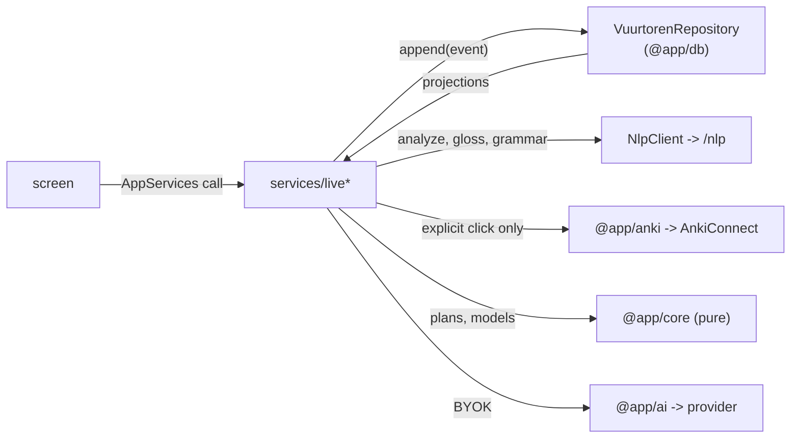

# Architecture

Which package owns what and how a click reaches the data.
Algorithms: [algorithms.md](algorithms.md).

## Packages

Dependencies point down; nothing in `packages/` imports from `apps/`.

| Package               | Owns                                                                                                                                                                                                                                                                    | Depends on                            |
| --------------------- | ----------------------------------------------------------------------------------------------------------------------------------------------------------------------------------------------------------------------------------------------------------------------- | ------------------------------------- |
| `packages/core`       | Pure domain logic: learner model and evidence, token matching, reading planner and staircase, practice engine and FSRS, the native scheduler (FSRS-6, replay, card templates, training data), courses, language profile and its mode, the `InspectorEntry` DTO. No I/O. | —                                     |
| `packages/content`    | Grammar topics and exam content (Markdown, generated and validated at build).                                                                                                                                                                                           | —                                     |
| `packages/db`         | The append-only event log, projections (native cards included) and the `VuurtorenRepository` API; drivers for browser SQLite (OPFS worker), Node and the desktop app's file; sync (`sync/`: encryption, the sync engine, the store interface).                          | core                                  |
| `packages/anki`       | AnkiConnect client, deck detection, snapshots, package files (.apkg, .colpkg) and decks read through AnkiConnect turned into native cards, and the one command layer for word actions in both modes (add, study first, mark known).                                     | core                                  |
| `packages/nlp-client` | HTTP client of `server/nlp` and the cached practice-data source.                                                                                                                                                                                                        | —                                     |
| `packages/ai`         | Bring-your-own-key providers, prompts, story / sentence / exam generators and their checks, the per-device key store.                                                                                                                                                   | core                                  |
| `packages/ui`         | Design-system components (reader, word inspector, cards, controls). Renders DTOs from core; no services.                                                                                                                                                                | core                                  |
| `packages/mcp-tools`  | The MCP tools of `apps/mcp`.                                                                                                                                                                                                                                            | core, content, db, ai                 |
| `apps/web`            | The React PWA.                                                                                                                                                                                                                                                          | all of the above                      |
| `apps/desktop`        | Tauri v2 app for computers and Android: local SQLite file, sync requests, key store; on a computer also the bundled language server, Anki bridge, sync folders, updater.                                                                                                | (loads apps/web)                      |
| `apps/mcp`            | stdio MCP server on the desktop app's data file.                                                                                                                                                                                                                        | mcp-tools, core, db, anki, nlp-client |
| `server/api`          | A Vuurtoren server: sign-in, sync tokens, the sync place (`/api/sync`) and the sign-in check of the language server (`/nlp/`). Holds no learner data.                                                                                                                   | —                                     |
| `server/nlp`          | Python language server: analysis (spaCy), dictionary, forms, sentences, grammar detectors, OCR (RapidOCR), translation.                                                                                                                                                 | —                                     |

Content that is data, not code, lives in `content/` under CC BY-SA 4.0 (`content/LICENSE`):
`content/starter/nl-5000.json`, the 5000 most common Dutch words with a gloss and an example
sentence, built by `server/nlp/scripts/build_starter.py` and committed. The web app imports it as
a chunk of its own (`apps/web/src/services/starterWords.ts`), loaded on first use and precached by
the service worker, so starter decks work offline in the browser and the desktop app.

`content/stories/<level>/<slug>.md` holds the graded stories (A1–B2): front matter, then each
Dutch sentence on its own line followed by its English on a `> ` line.
`server/nlp/scripts/check_stories.py` checks each story against its level (length, share of words within the level's
part of the starter list, sentence length, one English line per sentence) and with `--write`
bundles them, with their spaCy analysis, into `content/stories/stories.json`. The web app imports
the bundle as a chunk of its own (`apps/web/src/services/stories.ts`), precached like the starter
list. Read's Stories for you shelf computes the learner's coverage of each story from the bundled
analysis (`classifyTokens` and `coverageOf`, the reader's rule) and puts the learner's level first;
opening a story adds it to Your texts once as a normal text (source ref `story:<slug>`) with that analysis, so it reads at once
and offline. Side by side uses the story's English instead of machine translation: the language
server only pairs its words, and without the server the English shows alone. How to add a story:
`content/stories/README.md`.

## apps/web

```
src/
  main.tsx            boot: demo / desktop app / browser (signed in to the page's server) -> AppServices
  router.tsx          routes (lazy screens)
  shell/              app shell, PageHeader, degraded indicator, sign-in, start screens, auto sync
  screens/            one folder per area where it has several files:
    courses/ exam/ grammar/ onboarding/ reader/ review/ settings/ words/
    Read (Today, Stories for you, Your texts), Import, ReaderPage, Practice, Progress, Converse, ...
    words/WordsRoom: the Words tabs (Your words, Review, Practice, Progress) and the level summary
  services/           everything the screens call (AppServices), see below
  storage/            startup mode, tab lock, local.ts (localStorage helpers)
  auth/               sign-in client and sync tokens of a Vuurtoren server
  desktop/            the app's bridge, setup, data file and lock screens
  platform/           what each device can do: browser, desktop, android (currentDevice())
  sync/               sync places (server, WebDAV, folder), the key store, pairing links
  pwa/                service worker registration, update prompt, install button
  practice/           practice engine glue (core generators, speech)
  exam/               exam timer and helpers
  native/             workers: the FSRS optimizer (WebAssembly) and SQLite for package files
  format.ts           pct, plural, formatBytes, relativeTime
```

Screens only talk to `AppServices` (`services/types.ts`) through `useServices()`. They never
import `@app/db`, `@app/anki` or `@app/nlp-client` directly.

The service worker is `apps/web/sw/sw.js`, filled in and emitted as `/sw.js` by the
`vuurtoren-sw` plugin in `vite.config.ts` (built app only): it precaches the app shell (scripts,
styles, SQLite wasm, latin fonts, icons, `offline.html`), answers navigations network first
(offline: the cached shell), and never touches `/api`, `/nlp`, `/anki` or other origins.

### Services

`createLiveServices(repo, { remoteChanged?, platform? })` in `services/live.ts` is the
composition root. Each domain module gets only what it needs:

| Module              | Domain                                                                                                            |
| ------------------- | ----------------------------------------------------------------------------------------------------------------- |
| `platform.ts`       | `Platform`: `fetch` and device storage; `browserPlatform()` by default.                                           |
| `liveSettings.ts`   | Settings (secrets in device storage), the NLP and AnkiConnect clients, Anki connection status.                    |
| `liveLearner.ts`    | Learner-model and staircase cache with a version counter (`changed()` makes plans stale).                         |
| `liveDictionary.ts` | Glosses (card gloss, then Wiktionary), sentence translation, word meanings in the sentence, cached.               |
| `liveTexts.ts`      | Import, analysis, Library list, reading plans, lookups, cloze answers, finished segments.                         |
| `liveWords.ts`      | Inspector entry, words of a text, word actions, Anki sync, Words list, suggestions.                               |
| `liveProfile.ts`    | Language profile, deck choices, Anki snapshot of the profile's sources.                                           |
| `livePractice.ts`   | Practice sessions, answers, `buildWordData` (shared with courses).                                                |
| `liveGrammar.ts`    | Grammar hits of a text, topic overview and examples.                                                              |
| `liveAI.ts`         | AI config and keys, stories, conversations, AI sentences, exam items.                                             |
| `liveExam.ts`       | Exam attempts.                                                                                                    |
| `liveNative.ts`     | Native mode: review queue, answers and undo, deck options, package import, the move from Anki, FSRS tuning.       |
| `liveSync.ts`       | Sync: the place, its credentials and the key on this device; pairing; one sync at a time; syncs by itself (10.6). |
| `liveCourses.ts`    | Composition of `courses/`: `context` (shared lookups), `import`, `packs`, `views`, `anki`, `practice`, `grammar`. |

`mock*.ts` implement the same `AppServices` for `?demo` and for screen tests.

## Data flow



- **Writes** are events appended to the log (`TextImported`, `NoteAdded`, `ExerciseAnswered`,
  ...). Projections in `@app/db` turn them into tables; nothing writes a table directly, except
  the analysis cache below.
- **Analysis cache.** Tokens and grammar hits from the language server are derived data:
  `saveTextAnalysis` and `saveTextGrammar` write them to `text_tokens` and `text_grammar` on
  this device, never as events, so sync never carries them. One row per text, valid for its content hash and analyzer version;
  `analyzed_at` keeps a replayed `TextAnalyzed` event from an older log from overwriting a newer
  analysis. Rebuilds keep the cache; a text without an analysis is analysed when opened.
- **Reads** go through repository queries; the services cache what is expensive (learner model,
  reading plans, glosses) and drop the caches on `changed()` or when sync brought another
  device's changes (`autoSync`).
- **Modes.** The language profile's mode decides who holds the cards. Connected: Anki is read
  for snapshots and live card state and written only by the commands in `@app/anki`, each of
  which also records its event. Native: the cards are events and projections in `@app/db`
  (`NativeNotesAdded`, `CardReviewed`, `CardReviewUndone`, `NativeCardsChanged`,
  `NativeDeckOptionsSet`, `FsrsParamsSet`); the learner model reads them in place of the Anki
  snapshot, and the same commands act on them. Anki is only read, by the move from Anki.
- **Native reviews** are scheduled on the device (`@app/core` native scheduler). The FSRS
  optimizer runs in a worker as WebAssembly; a package file's SQLite collection is opened in
  another worker. Both work offline, in the browser and in the desktop app.
- **Degraded modes** (NLP, Anki, AI, translation, storage) report to one signal
  (`services/degraded.ts`) shown in the top bar.

## A Vuurtoren server

A server gives devices sync and the language server; it keeps no learner data and serves no
app. nginx (`deploy/nginx.conf.template`) serves one page, **Your devices** (`deploy/devices`:
sign in, add a device with a pairing code, remove one), and proxies `/api/` to `server/api` and
`/nlp/` to `server/nlp`, asking `/api/auth/check` first (`auth_request`). The check accepts a
session cookie, the server's `VUURTOREN_TOKEN` or, for `/api/sync` and `/nlp/`, a device's sync
token. A phone that syncs with a server uses that server's `/nlp` with its sync token; the
desktop app uses its bundled one.

Text bundles: a text's analysis, grammar hits and per-sentence extras (`text_extras`: English,
word pairs, in-context meanings) are derived data, never events. The device that made them puts
them in its own sync folder (`devices/<id>/analyses/`, sealed); a device with no analysis of a
text takes them from there (`packages/db/src/sync/engine.ts`, `apps/web/src/services/liveExtras.ts`).

## Language server OCR

`POST /ocr` (one upload) and `POST /course/ocr` (a whole book, as a background job) share one
pipeline in `server/nlp`: PDF pages keep a usable text layer (`pdf.py`), other pages are
cleaned up (`straighten.py`: page found in a photo, flattened, deskewed, dewarped) and read by
RapidOCR (`rapid.py`, PaddleOCR models on ONNX Runtime; `ocr.py`), Dutch only. It produces
words with boxes and confidences, from which the text, the layout blocks and the review flags
(`ocr_review.py`) are built.
RapidOCR and its models come with the `ocr` extra of the Python package: the standard image and
the desktop sidecar have it (about 280 MB installed, 120 MB compressed: OpenCV 170 MB, ONNX
Runtime 73 MB, models 32 MB), the `-slim` image has no OCR. `GET /health` reports `ocr` and
`ocrEngine`; the web app offers photos and scanned PDFs only when `ocr` is true.

## Language server data packs

The NLP image holds code and libraries only; its data are versioned **data packs** on the
`/data` volume (`server/nlp/src/vuurtoren_nlp/packs.py`, manifest `packs.json` next to it):

| pack                  | contents                                  | archive | installed |
| --------------------- | ----------------------------------------- | ------- | --------- |
| `dictionary-nl`       | Wiktionary (Kaikki) glosses, forms        | 14 MB   | 39 MB     |
| `sentences-nl`        | Tatoeba sentences + lemma index           | 20 MB   | 47 MB     |
| `mt-nl-en`            | OPUS-MT nl→en, CTranslate2 int8           | 70 MB   | 84 MB     |
| `grammar-examples-nl` | derived: example sentences per topic      | 0.1 MB  | 0.4 MB    |
| `audio-nl`            | optional: spoken starter words, sentences | —       | —         |

- **Manifest**: `{name: {version, sha256, size}}`; the archive is `<name>-<version>.tar.gz`
  (deterministic tar.gz of one file or directory). A marker `<data>.pack.json` records what is
  installed (version, digest, source).
- **Install** (at startup in a background thread, and on `POST /nlp/admin/packs`): each missing
  or outdated pack comes from `VUURTOREN_PACKS_DIR` (bundled archives: the `-full` image, the
  desktop sidecar), else `VUURTOREN_PACKS_URL` (release assets; optional `VUURTOREN_PACKS_TOKEN`),
  else, with `VUURTOREN_PACKS=auto`, a local build from the pinned upstream sources with
  `scripts/`. Archives are size- and SHA-256-checked, unpacked next to the target and renamed into
  place; caches holding the old data are dropped. Data without a marker (a development build) is
  never replaced unless forced. Works offline once installed. `GET /health` shows
  `packs.items.<name>.state` (`ok`, `outdated`, `unversioned`, `missing`) and `activity`.
- **Grammar examples** are derived from the sentence pack and the grammar detectors, so they are
  not in `packs.json`. `build_packs.py` writes
  `grammar-examples-nl-<sentences version>-<detector hash>.tar.gz` next to the archives
  (`--grammar-from DIR` builds it from the sentence pack archive in `DIR`). The offline installer
  and the `-full` image bundle it, and the server unpacks it when it fits the installed sentences
  and the current detectors. The standard installer and the standard image build it on the device
  after the sentence pack arrives (about a minute), as they do when the detectors change.
- **Audio** (`audio-nl`, optional, about 230 MB): the starter words, their example sentences and
  the bundled stories (sentences and paragraphs) spoken with Google Chirp 3 HD, Aoede and Charon
  (`scripts/tts_google.py`, [audio](audio.md)), laid out as `audio-nl/{female,male}/<id>.mp3`
  with `audio-nl/stories.json`, where the id comes from the text
  ([algorithms](algorithms.md#99-starter-words)). Without it, `ensure()` reports the pack and the
  app uses the system voice. The language server serves `GET /audio/<voice>/<id>.mp3` (404 when the
  clip or the pack is missing; on the desktop, the bundled server). The app fetches clips through
  its language-server client, caches them per session, and falls back to the system voice, then to
  nothing; `.apkg` exports carry the clips as `[sound:<id>.mp3]`.
- **Releasing new data**: bump the pack's version in `packs.json`, run
  `uv run python scripts/build_packs.py --out dist/packs`, upload `dist/packs/*` as assets of a
  `packs-<version>` release (the `packs` workflow does both) and commit the updated `packs.json`.
  By default the server downloads them from this repository's GitHub releases.
- **Analyzer version**: `GET /health` and every `/analyze/text` result carry
  `analyzerVersion` (hash of the spaCy/model/library versions, the token-shaping modules, the
  grammar detectors and the installed dictionary pack). The analysis cache stores it
  (`text_tokens.analyzer_version`), and the repository records when each version first appeared
  on the device (`analyzerSeen`). The reader re-analyses a text once, in the background, when
  it is opened and its analysis is older than the device's analyzer; another device's analysis
  from an old log, or an older analyzer brought back, is kept. A new analyzer version drops the
  text's grammar hits.

## Checks

- `pnpm build && pnpm typecheck && pnpm lint && pnpm test && pnpm format:check`
- `pnpm e2e`: Playwright smoke test (`apps/web/e2e`) of import, reader, inspector, text size and
  practice, in demo and browser-storage mode, with the language server and AnkiConnect faked.
- `pnpm knip`: unused files, exports and dependencies.
- `npx madge@8.0.0 --circular --extensions ts,tsx <package>/src`: no import cycles.
- `server/nlp`: `uv run ruff check && uv run ruff format --check && uv run pytest -q`.
